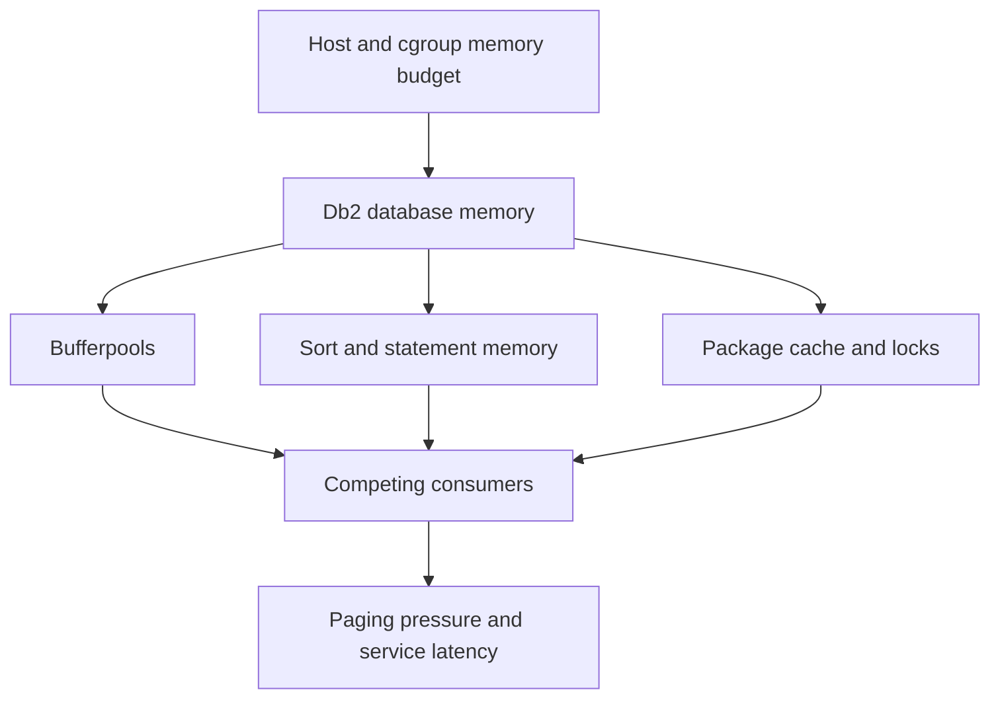

# H-06 — Bufferpools, sort, package cache, memory pressure, and competing consumers

**Procedure status: NOT YET EXECUTED.** This is a teaching procedure for Db2 LUW 12.1.0 on Linux x86-64, single-member topology. The exact fix pack is not pinned. Engine commands run on the Db2 server as the named instance/database authority; client checks run on the client; OS commands run on the named host and normally require read-only access. Windows, AIX, DPF, and pureScale differences are called out where material. The supplied environment has no Db2 CLI or disposable Db2 server, so no lab command is claimed as executed. Before production use, confirm each command against the installed fix pack and local change controls.

## 1. Quick answer

Use this lesson to make a bounded DBA decision about bufferpool logical/physical reads and page size, sort heap/temp spill, package cache hits/evictions/compile. The key is to identify the failing layer and scope before changing state.

**Safest first step:** Capture the current target, timestamp, release, and read-only state before acting.

## 2. Learn the concept

The useful mental model is to follow bufferpool logical/physical reads and page size; sort heap/temp spill; package cache hits/evictions/compile; lock list and statement memory; STMM and database memory; db2pd memory sets; host paging/NUMA/cgroup; parameter scope/change class; avoid starving another consumer from the service boundary inward. Record who owns each boundary and which evidence is authoritative there.

### Working model

Scope: bufferpool logical/physical reads and page size → sort heap/temp spill → package cache hits/evictions/compile → lock list and statement memory → STMM and database memory → db2pd memory sets → host paging/NUMA/cgroup → parameter scope/change class → avoid starving another consumer. The arrows represent dependency, not proof of a fault. Confirm each hop independently.



## 3. Choose an approach

| Variant | Choose it when | Do not choose it when / boundary |
|---|---|---|
| Bufferpool | Tune repeated physical reads for matched page size/table space. | Very large pool can starve sort/agents/OS. |
| Sort/package cache | Use spill/cache evidence and statement compilation metrics. | A cache hit ratio alone does not prove service improvement. |
| STMM/overall memory | Let supported automatic tuning balance eligible consumers. | Fixed component caps and host/cgroup limits still constrain engine. |

## 4. Understand the lifecycle

- Collect host memory and Db2 memory-set baseline.
- Map table spaces/bufferpools and identify query spill/cache metrics.
- Determine automatic/manual parameter and propagation class.
- Change one consumer within host headroom and test competing workloads.
- Revert or adjust if paging, tail latency or another component regresses.

**Pause/retry/stop/rollback rule:** Stop if the target identity, current state, authority, or rollback dependency is uncertain; preserve evidence and escalate.

## 5. Do the work

### Precheck

- Read GET DB CFG SHOW DETAIL and `db2pd -db SAMPLE -memsets`.
- Check page sizes, bufferpool mapping and temporary table spaces.
- Set maximum memory budget including OS, filesystem cache and non-Db2 process.

### Scoped procedures

### Procedure 1: Inspect memory sets

**Status:** NOT YET EXECUTED. **Run as:** Instance owner. **Target:** SAMPLE active database and local member. **Authority/prerequisite:** Read-only; check options on current release/topology.

```bash
db2pd -db SAMPLE -memsets; db2pd -db SAMPLE -bufferpools
```

**Expected result:** Memory component and bufferpool state are displayed.

**Independent check:** Compare to MON_GET_BUFFERPOOL, sort activity and OS paging/cgroup over interval.

**Stop/rollback boundary:** Read-only.

### Procedure 2: Change one lab consumer

**Status:** NOT YET EXECUTED. **Run as:** DBA config authority. **Target:** Disposable SAMPLE database. **Authority/prerequisite:** Only after spill evidence; check unit/page semantics, online class, database memory and host headroom.

```bash
UPDATE DATABASE CONFIGURATION FOR SAMPLE USING sortheap 4096
```

**Expected result:** Sort heap configured; current/deferred value may differ by parameter class.

**Independent check:** GET DB CFG SHOW DETAIL; replay sort and competing OLTP workload, measure spill and memory.

**Stop/rollback boundary:** Restore previous value; if parameter applies on reactivate, schedule safely and verify effective value.

## 6. Worked example and verification

A sort spills to temporary tablespace. Raising SORTHEAP may reduce spill but multiply memory per concurrent sort; compare overall database memory and concurrency. If host begins swapping, revert rather than tune package cache concurrently.

**Expected state/result:** A single memory consumer is tied to measured pressure and tested without starving Db2 or host neighbors.

**Independent verification:**

- Compare the post-state with the captured pre-state.
- Confirm the intended service or data outcome independently of the command return code.

## 7. Diagnose problems

| Symptom or verified error | Evidence to collect | Likely cause | Safe correction and recheck | Avoid |
|---|---|---|---|---|
| Bufferpool hit ratio improves but end-to-end latency worsens. | physical reads, CPU, page cleaner, memory-set pressure, paging and query p95. | Larger pool uses memory needed by other components or misses are not bottleneck. | Return to tested size and identify actual wait/cost component. | Optimizing a ratio without service-level measurement. |
| Sort memory increase causes paging or OOM. | concurrent sorts, sort heap, database memory, cgroup usage and OOM logs. | Per-activity allocation multiplied by concurrency beyond host budget. | Restore old parameter/limit concurrency while protecting recovery headroom. | Setting every heap to maximum. |

## 8. Practice

Run a sort-heavy lab query at two concurrency levels. Capture sort spill, memory sets, host paging and temporary space. Change only SORTHEAP; compare all metrics and rollback.

## 9. Check understanding

**Question:** Why can a low physical-read ratio coexist with slow SQL?

**Answer and reasoning:** CPU, lock, network, sort, compile or logging waits may dominate. Bufferpool metrics need to be interpreted with end-to-end activity time.

## 10. Look it up later

### Short checklist

- Name the target and scope.
- Collect a baseline and confirm prerequisites.
- Choose the least disruptive supported branch.
- Verify state and service behavior.
- Record evidence and recovery limits.

### Related lessons

[B-05](../B/B-05.md) · [E-03](../E/E-03.md) · [H-01](../H/H-01.md) · [H-07](../H/H-07.md)

### Authoritative references

- [IBM configuration parameter summary](https://www.ibm.com/docs/en/db2/12.1.x?topic=parameters-configuration-summary)
- [IBM MON routines](https://www.ibm.com/docs/en/db2/12.1.x?topic=functions-monitor-mon-routines)
- [IBM bufferpool monitor function](https://www.ibm.com/docs/en/db2/12.1.x?topic=routines-mon-get-bufferpool)

---

[Domain index](README.md) · [Course index](../README.md) · [Glossary](../GLOSSARY.md)
