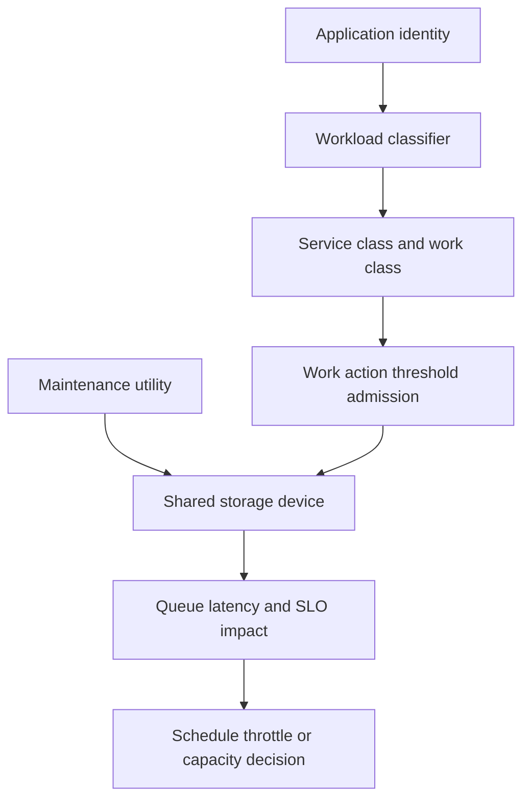

# H-07 — Workload management, I/O, utility contention, and maintenance tuning

**Procedure status: NOT YET EXECUTED.** This is a teaching procedure for Db2 LUW 12.1.0 on Linux x86-64, single-member topology. The exact fix pack is not pinned. Engine commands run on the Db2 server as the named instance/database authority; client checks run on the client; OS commands run on the named host and normally require read-only access. Windows, AIX, DPF, and pureScale differences are called out where material. The supplied environment has no Db2 CLI or disposable Db2 server, so no lab command is claimed as executed. Before production use, confirm each command against the installed fix pack and local change controls.

## 1. Quick answer

Use this lesson to make a bounded DBA decision about workload/service/work class/work action/threshold lifecycle, admission control and concurrency, WLM collection and threshold effects. The key is to identify the failing layer and scope before changing state.

**Safest first step:** Capture the current target, timestamp, release, and read-only state before acting.

## 2. Learn the concept

The useful mental model is to follow workload/service/work class/work action/threshold lifecycle; admission control and concurrency; WLM collection and threshold effects; utility throttling/contention; I/O path/latency/queue depth/prefetch; maintenance window and priority; queueing versus device saturation from the service boundary inward. Record who owns each boundary and which evidence is authoritative there.

### Working model

Scope: workload/service/work class/work action/threshold lifecycle → admission control and concurrency → WLM collection and threshold effects → utility throttling/contention → I/O path/latency/queue depth/prefetch → maintenance window and priority → queueing versus device saturation. The arrows represent dependency, not proof of a fault. Confirm each hop independently.



## 3. Choose an approach

| Variant | Choose it when | Do not choose it when / boundary |
|---|---|---|
| WLM routing | Map app/user/work type to service class and resources. | Test classification with actual client attributes. |
| Admission/threshold | Protect service by limiting concurrency or detecting runaway work. | Threshold action can cancel/collect and affect workloads. |
| I/O and utility | Measure device queue/latency and utility resource use. | A slower utility may be caused by contention, not utility setting. |

## 4. Understand the lifecycle

- Classify workloads and service objectives.
- Measure queueing and resource saturation by class and device.
- Design WLM object hierarchy and utility maintenance window.
- Test work-class mapping and threshold on lab workload.
- Observe queue/latency and rebalance maintenance priorities.

**Pause/retry/stop/rollback rule:** Stop if the target identity, current state, authority, or rollback dependency is uncertain; preserve evidence and escalate.

## 5. Do the work

### Precheck

- Inventory existing WLM objects and monitor collection.
- Check if app attributes reliably distinguish workload.
- Record I/O baseline and utility impact; ensure backup/REORG windows do not collide.

### Scoped procedures

### Procedure 1: Create workload mapping example

**Status:** NOT YET EXECUTED. **Run as:** WLMADM or DBADM. **Target:** Disposable database and service class REPORTS_SC. **Authority/prerequisite:** Create service class before workload; validate exact syntax and role mapping in lab.

```bash
CREATE SERVICE CLASS REPORTS_SC; CREATE WORKLOAD REPORTS_WL SESSION_USER ('REPORTS') SERVICE CLASS REPORTS_SC
```

**Expected result:** REPORTS session identity maps to service class.

**Independent check:** Query MON_GET_WORKLOAD/MON_GET_SERVICE_SUBCLASS to verify app classification and resource metrics.

**Stop/rollback boundary:** Drop workload then service class only after lab sessions disconnect.

### Procedure 2: Measure device and utility impact

**Status:** NOT YET EXECUTED. **Run as:** Linux host operator and Db2 instance owner. **Target:** Storage device plus current database utilities. **Authority/prerequisite:** Align interval; read-only collection; identify device/container mapping.

```bash
iostat -xz 1 5; LIST UTILITIES SHOW DETAIL
```

**Expected result:** Device latency/queue and Db2 utility phase are visible.

**Independent check:** Compare with baseline and service latency; change utility priority only in controlled window.

**Stop/rollback boundary:** Stop/reschedule utility only through its supported pause/resume/terminate lifecycle.

## 6. Worked example and verification

A RUNSTATS utility overlaps a latency-sensitive checkout service. WLM may control query work but cannot fix a saturated disk. Compare checkout class wait/latency, device queue and utility phase; shift maintenance window or throttle only after bottleneck evidence.

**Expected state/result:** User workload, utility and storage queues are separated; WLM classification and action are verified with monitoring.

**Independent verification:**

- Compare the post-state with the captured pre-state.
- Confirm the intended service or data outcome independently of the command return code.

## 7. Diagnose problems

| Symptom or verified error | Evidence to collect | Likely cause | Safe correction and recheck | Avoid |
|---|---|---|---|---|
| All work lands in default service subclass. | client attributes, workload definition, priority/sequence and `MON_GET_WORKLOAD`. | Classifier does not match real application identity/connection attributes. | Correct narrow workload predicate and test with actual application driver. | Creating more service classes without classification evidence. |
| Utility slows but user latency remains high. | device latency, queue depth, utility progress/phase and tablespace path. | Storage saturation or utility competing for shared device. | Reschedule/throttle utility or isolate storage after storage-owner review. | Changing WLM threshold to cancel user work without business approval. |

## 8. Practice

Create one service class and a workload for synthetic reporting identity. Verify classification; run a low-volume maintenance utility and inspect device/Db2 metrics. Do not tune thresholds under actual service load.

## 9. Check understanding

**Question:** Can WLM fix storage saturation?

**Answer and reasoning:** WLM can route/admit/control eligible work but does not add device capacity. Identify I/O queue/latency and utility sharing before choosing workload controls.

## 10. Look it up later

### Short checklist

- Name the target and scope.
- Collect a baseline and confirm prerequisites.
- Choose the least disruptive supported branch.
- Verify state and service behavior.
- Record evidence and recovery limits.

### Related lessons

[C-06](../C/C-06.md) · [E-06](../E/E-06.md) · [H-01](../H/H-01.md) · [H-06](../H/H-06.md) · [J-05](../J/J-05.md)

### Authoritative references

- [IBM workload service classes](https://www.ibm.com/docs/en/db2/12.1.x?topic=environment-using-workload-types-simplify-service-class-creation)
- [IBM work action sets](https://www.ibm.com/docs/en/db2/12.1.0?topic=sets-creating-work-action)
- [IBM MON routines](https://www.ibm.com/docs/en/db2/12.1.x?topic=functions-monitor-mon-routines)
- [Linux iostat manual](https://man7.org/linux/man-pages/man1/iostat.1.html)

---

[Domain index](README.md) · [Course index](../README.md) · [Glossary](../GLOSSARY.md)
