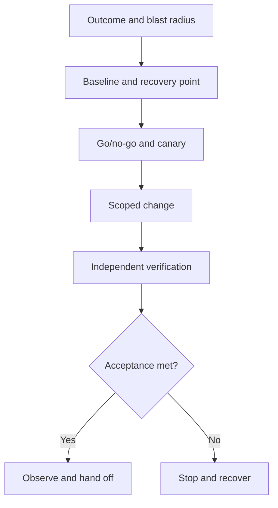

# I-01 — Production change design, blast radius, stop criteria, rollback, and acceptance

**Procedure status: NOT YET EXECUTED.** This is a teaching procedure for Db2 LUW 12.1.0 on Linux x86-64, single-member topology. The exact fix pack is not pinned. Engine commands run on the Db2 server as the named instance/database authority; client checks run on the client; OS commands run on the named host and normally require read-only access. Windows, AIX, DPF, and pureScale differences are called out where material. The supplied environment has no Db2 CLI or disposable Db2 server, so no lab command is claimed as executed. Before production use, confirm each command against the installed fix pack and local change controls.

## 1. Quick answer

Use this lesson to make a bounded decision about change objective and blast radius, precheck and pre/post evidence, canary and measurable acceptance. Confirm target, authority, state, and recovery boundary before changing anything.

**Safest first step:** Capture the exact target, release, role, timestamp, and read-only state before acting.

## 2. Learn the concept

Follow change objective and blast radius; precheck and pre/post evidence; canary and measurable acceptance; stop/go criteria and rollback trigger; configuration versus data recovery; handoff and closure across the service boundary. Each stage has its own owner and evidence; a successful command is not proof of the business outcome.

### Working model

Decision path: change objective and blast radius → precheck and pre/post evidence → canary and measurable acceptance → stop/go criteria and rollback trigger → configuration versus data recovery → handoff and closure. The arrows are dependencies to verify, not proof of causality.



## 3. Choose an approach

| Variant | Choose it when | Do not choose it when / boundary |
|---|---|---|
| Reversible configuration | Capture current value, activation behavior, and tested reverse action. | Reversal does not undo workload side effects. |
| Data or format change | Require a recoverable copy and rehearsed restore route. | Rollback may mean recovery, not inverse SQL. |
| Topology/role change | Require fencing, client route, and single-writer plan. | A second writer risks data corruption. |

## 4. Understand the lifecycle

- State user outcome, scope, owner, dependencies, and risk.
- Capture target, role, health baseline, and recovery point.
- Define canary, acceptance measures, stop triggers, and decision owner.
- Apply the smallest scoped step and pause at gates.
- Compare independent post-state and representative workload.
- Record recovery decision, result, and handoff.

**Pause/retry/stop/rollback rule:** Stop if target identity, role, authority, prerequisites, data-loss decision, or rollback path is uncertain; preserve evidence and escalate.

## 5. Do the work

### Precheck

- Confirm authority, on-call/application owner, window, and exact target.
- Save current configuration and topology evidence.
- Keep recovery materials available outside the changed component.

### Scoped procedures

### Procedure 1: Capture baseline

**Status:** NOT YET EXECUTED. **Run as:** Instance owner. **Target:** Named instance and SAMPLE database. **Authority/prerequisite:** Read-only; record release, host, role, time, and change ID.

```bash
db2 get dbm cfg; db2 get db cfg for SAMPLE; db2pd -db SAMPLE -alldbs
```

**Expected result:** Configuration and engine state are captured.

**Independent check:** Compare post-state and test application transactions independently.

**Stop/rollback boundary:** Read-only.

### Procedure 2: Illustrative scoped change

**Status:** NOT YET EXECUTED. **Run as:** Instance owner with approval. **Target:** SAMPLE database. **Authority/prerequisite:** Example only: verify current value, activation, retry behavior, acceptance threshold, and prior value.

```bash
db2 update db cfg for SAMPLE using LOCKTIMEOUT 30
```

**Expected result:** Db2 accepts the update; activation depends on parameter.

**Independent check:** Requery effective value and compare lock waits, errors, and app latency.

**Stop/rollback boundary:** Restore recorded value through approved change; investigate side effects separately.

## 6. Worked example and verification

A shorter lock timeout may reduce queues but increase app errors. Acceptance must cover both lock wait and retry/error behavior.

**Expected state/result:** Change record names impact, target, owner, baseline, canary, thresholds, actual result, recovery boundary, and handoff.

**Independent verification:**

- Compare pre-state and post-state from independent evidence.
- Validate the affected application or business transaction, not only the Db2 return code.

## 7. Diagnose problems

| Symptom or verified error | Evidence to collect | Likely cause | Safe correction and recheck | Avoid |
|---|---|---|---|---|
| Accepted change but no service effect | target scope, effective value, activation, member, and app telemetry | wrong scope or deferred activation | confirm scope and activate only in approved window | repeat across databases without checking scope |
| Rollback restores value but not service | timeline, utilities, retries, route changes, and data effects | consequences were not fully reversible | stabilize and follow data/topology recovery plan | assume old config recreates old service |

## 8. Practice

Tabletop a benign parameter change: baseline, canary, app acceptance, stop trigger, rollback value, and adverse result. No live mutation; NOT YET EXECUTED.

## 9. Check understanding

**Question:** What makes a stop criterion actionable?

**Answer and reasoning:** It is measurable, time-bounded, tied to user/data impact, and names the decision owner and recovery action.

## 10. Look it up later

### Short checklist

- Name the host, instance, database, member, and role.
- Capture baseline and confirm prerequisites.
- Choose the supported and least disruptive branch.
- Verify state and service behavior independently.
- Record evidence, owner, and recovery boundary.

### Related lessons

[A-04](../A/A-04.md) · [E-06](../E/E-06.md) · [F-03](../F/F-03.md) · [I-02](../I/I-02.md) · [K-03](../K/K-03.md)

### Authoritative references

- [IBM configuration parameter summary](https://www.ibm.com/docs/en/db2/12.1.x?topic=parameters-configuration-summary)
- [IBM BACKUP DATABASE](https://www.ibm.com/docs/en/db2/12.1.x?topic=commands-backup-database)

---

[Domain index](README.md) · [Course index](../README.md) · [Glossary](../GLOSSARY.md)
