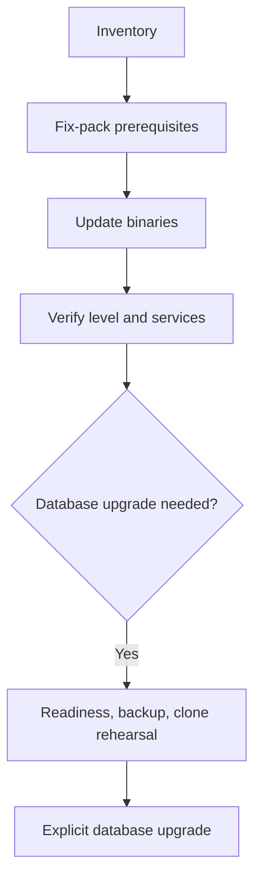

# I-02 — Fix packs, software maintenance, install copies, and topology sequencing

**Procedure status: NOT YET EXECUTED.** This is a teaching procedure for Db2 LUW 12.1.0 on Linux x86-64, single-member topology. The exact fix pack is not pinned. Engine commands run on the Db2 server as the named instance/database authority; client checks run on the client; OS commands run on the named host and normally require read-only access. Windows, AIX, DPF, and pureScale differences are called out where material. The supplied environment has no Db2 CLI or disposable Db2 server, so no lab command is claimed as executed. Before production use, confirm each command against the installed fix pack and local change controls.

## 1. Quick answer

Use this lesson to make a bounded decision about install copy and instance inventory, fix-pack installation method, online/offline restrictions. Confirm target, authority, state, and recovery boundary before changing anything.

**Safest first step:** Capture the exact target, release, role, timestamp, and read-only state before acting.

## 2. Learn the concept

Follow install copy and instance inventory; fix-pack installation method; online/offline restrictions; binary update versus database format change; post-update validation across the service boundary. Each stage has its own owner and evidence; a successful command is not proof of the business outcome.

### Working model

Decision path: install copy and instance inventory → fix-pack installation method → online/offline restrictions → binary update versus database format change → post-update validation. The arrows are dependencies to verify, not proof of causality.



## 3. Choose an approach

| Variant | Choose it when | Do not choose it when / boundary |
|---|---|---|
| In-place update | Use the documented installer method for the existing copy and topology. | A successful installer does not prove each instance is ready. |
| Out-of-place update | Install a second copy and switch instances under a tested plan. | Requires disk, client, and rollback planning. |
| Database format upgrade | Treat UPGRADE DATABASE as a separate, explicit change. | Replacing binaries does not reverse a database upgrade. |

## 4. Understand the lifecycle

- Inventory copies, instances, databases, clients, topology, and add-ons.
- Check target fix-pack prerequisites and supported install method.
- Verify recovery copy, compatibility, space, packages, and outage plan.
- Rehearse on a clone; record before/after levels and rollback boundary.
- Update binaries; separately execute any approved database upgrade.
- Validate connections, critical transactions, backup, restore, and HA.

**Pause/retry/stop/rollback rule:** Stop if target identity, role, authority, prerequisites, data-loss decision, or rollback path is uncertain; preserve evidence and escalate.

## 5. Do the work

### Precheck

- Record db2level, db2ls, db2licm -l, instance and database inventory.
- Identify all instances using this copy and topology-specific restrictions.
- Verify a recent recoverable backup and documented installer recovery path.

### Scoped procedures

### Procedure 1: Inventory code

**Status:** NOT YET EXECUTED. **Run as:** Instance owner / host operator. **Target:** Selected install copy and instance. **Authority/prerequisite:** Run under the intended Db2 profile; save pre-change evidence.

```bash
db2level; db2ls; db2licm -l
```

**Expected result:** Current code, installation path, and registered products are displayed.

**Independent check:** Reconcile every instance and product with the change manifest.

**Stop/rollback boundary:** Read-only.

### Procedure 2: Illustrative update

**Status:** NOT YET EXECUTED. **Run as:** Privileged installer. **Target:** One approved Db2 install copy. **Authority/prerequisite:** Read target README and exact flags; confirm free space, method, instance scope, backups, and outage approval.

```bash
./installFixPack -b /opt/ibm/db2/V12.1
```

**Expected result:** Installer completes with a successful summary.

**Independent check:** Run db2level per instance and test applications, backup, restore, and HA.

**Stop/rollback boundary:** Follow the documented method-specific recovery; do not assume binary rollback undoes a database UPGRADE.

## 6. Worked example and verification

Track target binary level and database format as separate change items. A fix pack can update the copy while a database still requires a planned upgrade.

**Expected state/result:** The change record names source/target levels, method, affected instances, database-upgrade decision, validation, and tested recovery boundary.

**Independent verification:**

- Compare pre-state and post-state from independent evidence.
- Validate the affected application or business transaction, not only the Db2 return code.

## 7. Diagnose problems

| Symptom or verified error | Evidence to collect | Likely cause | Safe correction and recheck | Avoid |
|---|---|---|---|---|
| Instance will not start | installer logs, db2level, environment path, instance-update status, db2diag | wrong copy, incomplete instance update, or missing OS prerequisite | stop traffic, preserve logs, and follow the exact installer recovery procedure | copy arbitrary binaries or rerun the update blindly |
| Connections fail after update | SQLCODE, database upgrade state, db2diag, client/server levels | database upgrade omitted or incompatible client/runtime | rehearse and execute a separately approved upgrade if required | run UPGRADE DATABASE reactively |

## 8. Practice

On disposable systems, update a clone, capture levels, update one instance, test clients and backup/restore, then exercise the documented rollback. No Db2 lab is available; NOT YET EXECUTED.

## 9. Check understanding

**Question:** Why are a fix pack and database upgrade separate checklist items?

**Answer and reasoning:** They change different state: installer binaries versus database structures and compatibility. Their prerequisites and rollback paths differ.

## 10. Look it up later

### Short checklist

- Name the host, instance, database, member, and role.
- Capture baseline and confirm prerequisites.
- Choose the supported and least disruptive branch.
- Verify state and service behavior independently.
- Record evidence, owner, and recovery boundary.

### Related lessons

[A-05](../A/A-05.md) · [B-02](../B/B-02.md) · [F-03](../F/F-03.md) · [G-01](../G/G-01.md) · [K-03](../K/K-03.md)

### Authoritative references

- [IBM fix-pack installation methods](https://www.ibm.com/docs/en/db2/12.1.x?topic=environments-fix-pack-installation-methods)
- [IBM installFixPack](https://www.ibm.com/docs/en/db2/12.1.x?topic=commands-installfixpack-update-installed-db2-database-products)
- [IBM Db2 installation methods](https://www.ibm.com/docs/en/db2/12.1.x?topic=servers-db2-installation-methods)

---

[Domain index](README.md) · [Course index](../README.md) · [Glossary](../GLOSSARY.md)
