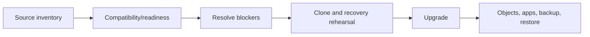

# I-03 — Db2 upgrade planning, prechecks, execution, application tests, and fallback limits

**Procedure status: NOT YET EXECUTED.** This is a teaching procedure for Db2 LUW 12.1.0 on Linux x86-64, single-member topology. The exact fix pack is not pinned. Engine commands run on the Db2 server as the named instance/database authority; client checks run on the client; OS commands run on the named host and normally require read-only access. Windows, AIX, DPF, and pureScale differences are called out where material. The supplied environment has no Db2 CLI or disposable Db2 server, so no lab command is claimed as executed. Before production use, confirm each command against the installed fix pack and local change controls.

## 1. Quick answer

Use this lesson to make a bounded decision about source/target compatibility, readiness verification, blocker resolution. Confirm target, authority, state, and recovery boundary before changing anything.

**Safest first step:** Capture the exact target, release, role, timestamp, and read-only state before acting.

## 2. Learn the concept

Follow source/target compatibility; readiness verification; blocker resolution; database upgrade execution; packages and application behavior; recovery boundary across the service boundary. Each stage has its own owner and evidence; a successful command is not proof of the business outcome.

### Working model

Decision path: source/target compatibility → readiness verification → blocker resolution → database upgrade execution → packages and application behavior → recovery boundary. The arrows are dependencies to verify, not proof of causality.



## 3. Choose an approach

| Variant | Choose it when | Do not choose it when / boundary |
|---|---|---|
| In-place upgrade | Use only on a supported path with outage and recovery plan. | Restoring old binaries may not reverse upgraded database state. |
| Migration | Build a separate target when isolation or platform move requires it. | Requires complete data, object, and security reconciliation. |
| Defer | Resolve blockers or remain on a supported source level. | Do not suppress readiness findings to force the change. |

## 4. Understand the lifecycle

- Confirm supported source/target versions, platform, and topology.
- Run readiness checks on representative clone and inspect all findings.
- Resolve invalid objects, capacity, log, and package issues.
- Take and verify recovery copy; define no-return and rollback decision.
- Upgrade clone; compare workload and validate application paths.
- Execute approved sequence and verify objects, backup, restore, and HA.

**Pause/retry/stop/rollback rule:** Stop if target identity, role, authority, prerequisites, data-loss decision, or rollback path is uncertain; preserve evidence and escalate.

## 5. Do the work

### Precheck

- Capture exact source fix pack, OS, topology, codeset, registry, and configuration.
- Check all databases/partitions and retain full readiness output.
- Test client, driver, routine, utility, and critical SQL compatibility.

### Scoped procedures

### Procedure 1: Readiness check

**Status:** NOT YET EXECUTED. **Run as:** Instance owner. **Target:** Representative clone SAMPLE. **Authority/prerequisite:** Use target-version tool path and documented database-state prerequisites.

```bash
db2ckupgrade SAMPLE -l /db2upgrade/readiness.log
```

**Expected result:** Readiness log lists checked objects and findings.

**Independent check:** Review the complete log; prove every database and partition was examined.

**Stop/rollback boundary:** Read-only; a pass does not prove application compatibility.

### Procedure 2: Approved upgrade

**Status:** NOT YET EXECUTED. **Run as:** Instance owner with required authority. **Target:** Clone first; approved production target second. **Authority/prerequisite:** Verified backup/recovery path, supported path, stopped application traffic, capacity, and change approval.

```bash
db2 UPGRADE DATABASE SAMPLE
```

**Expected result:** Upgrade completes and supported connections succeed.

**Independent check:** Inspect db2diag, object/package validity, critical SQL, backup, and restore.

**Stop/rollback boundary:** Preserve evidence and follow documented recovery; do not rerun blindly or assume binary rollback is database rollback.

## 6. Worked example and verification

A readiness log flags an invalid routine and low log headroom. Resolve and rehearse both issues on the clone before scheduling the production change.

**Expected state/result:** Evidence includes readiness findings, rehearsal timing, upgrade result, critical app checks, new backup, restore proof, and recovery decision.

**Independent verification:**

- Compare pre-state and post-state from independent evidence.
- Validate the affected application or business transaction, not only the Db2 return code.

## 7. Diagnose problems

| Symptom or verified error | Evidence to collect | Likely cause | Safe correction and recheck | Avoid |
|---|---|---|---|---|
| Upgrade stops on a blocker | readiness log, SQLCODE, db2diag, object state, disk and log capacity | unsupported object/path or unmet prerequisite | preserve diagnostics, restore rehearsal, resolve cause, and retry on clone | repeat in-place attempts on the only recoverable copy |
| Database opens but one app regresses | package validity, driver, explain plan, SQL errors, transaction results | invalidated package or changed compatibility/optimizer behavior | scope rebind or compatibility changes after representative testing | change multiple registry/config values together |

## 8. Practice

Upgrade a disposable copy on a supported source-target path, address readiness warnings, verify objects and packages, compare workload, and test restore. No Db2 lab; NOT YET EXECUTED.

## 9. Check understanding

**Question:** What proves success beyond UPGRADE DATABASE returning successfully?

**Answer and reasoning:** Critical transactions/utilities work, objects and packages are valid, performance meets thresholds, HA and backup/restore work, and recovery limits are understood.

## 10. Look it up later

### Short checklist

- Name the host, instance, database, member, and role.
- Capture baseline and confirm prerequisites.
- Choose the supported and least disruptive branch.
- Verify state and service behavior independently.
- Record evidence, owner, and recovery boundary.

### Related lessons

[I-02](../I/I-02.md) · [C-07](../C/C-07.md) · [F-03](../F/F-03.md) · [G-01](../G/G-01.md) · [K-03](../K/K-03.md)

### Authoritative references

- [IBM upgrade readiness check](https://www.ibm.com/docs/en/db2/12.1?topic=tasks-verifying-that-your-databases-are-ready-upgrade)
- [IBM UPGRADE DATABASE](https://www.ibm.com/docs/en/db2/12.1.x?topic=commands-upgrade-database)
- [IBM upgrade restrictions](https://www.ibm.com/docs/en/db2/12.1.x?topic=servers-upgrade-restrictions)

---

[Domain index](README.md) · [Course index](../README.md) · [Glossary](../GLOSSARY.md)
