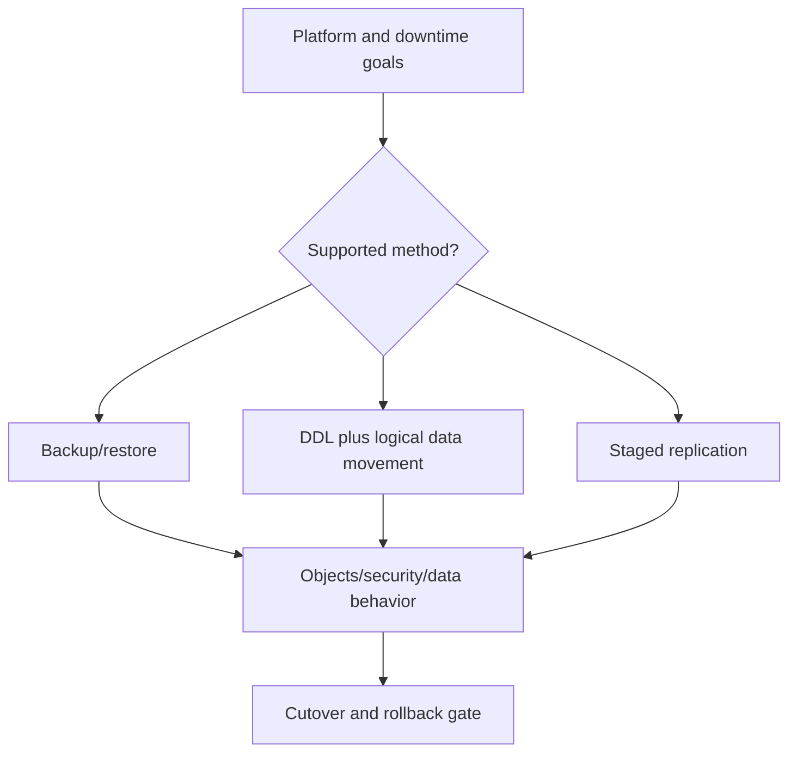

# I-04 — Cross-platform migration, compatibility, logical movement, and reconciliation

**Procedure status: NOT YET EXECUTED.** This is a teaching procedure for Db2 LUW 12.1.0 on Linux x86-64, single-member topology. The exact fix pack is not pinned. Engine commands run on the Db2 server as the named instance/database authority; client checks run on the client; OS commands run on the named host and normally require read-only access. Windows, AIX, DPF, and pureScale differences are called out where material. The supplied environment has no Db2 CLI or disposable Db2 server, so no lab command is claimed as executed. Before production use, confirm each command against the installed fix pack and local change controls.

## 1. Quick answer

Use this lesson to make a bounded decision about physical image portability, redirected restore mapping, logical movement tools. Confirm target, authority, state, and recovery boundary before changing anything.

**Safest first step:** Capture the exact target, release, role, timestamp, and read-only state before acting.

## 2. Learn the concept

Follow physical image portability; redirected restore mapping; logical movement tools; schema/security/identity completeness; cutover and delta capture; transaction reconciliation across the service boundary. Each stage has its own owner and evidence; a successful command is not proof of the business outcome.

### Working model

Decision path: physical image portability → redirected restore mapping → logical movement tools → schema/security/identity completeness → cutover and delta capture → transaction reconciliation. The arrows are dependencies to verify, not proof of causality.



## 3. Choose an approach

| Variant | Choose it when | Do not choose it when / boundary |
|---|---|---|
| Backup/restore | Use when exact OS, hardware, and release path is supported. | Do not infer portability from equal version numbers. |
| Logical movement | Use export/import/load/db2move for unsupported image paths or selective scope. | Recreate behavior-bearing DDL, grants, and identity state. |
| Staged replication | Use only with product support, licensing, and cutover/reconciliation design. | Define lag, conflict, and final sync decision. |

## 4. Understand the lifecycle

- Set platform, scope, outage, codeset, RPO, and rollback target.
- Check official portability and release compatibility.
- Inventory DDL, grants, routines, sequence/identity state, special types, and dependencies.
- Move representative objects/data and compare behavior.
- Freeze writes or capture final deltas; validate and cut over.
- Keep source recoverable/read-only through the reconciliation window.

**Pause/retry/stop/rollback rule:** Stop if target identity, role, authority, prerequisites, data-loss decision, or rollback path is uncertain; preserve evidence and escalate.

## 5. Do the work

### Precheck

- Record source/target Db2 level, OS, architecture, codeset, page size, and topology.
- Plan keys, external routines, replication/federation, temporary space, and transfer capacity.
- Define row, constraint, identity, grant, and app transaction reconciliation.

### Scoped procedures

### Procedure 1: Capture source definition

**Status:** NOT YET EXECUTED. **Run as:** Migration DBA. **Target:** Source catalog and object definitions. **Authority/prerequisite:** Protect output; it may contain identifiers or sensitive definitions.

```bash
db2look -d SRCDB -e -a -l -x -o /migration/srcdb.sql
```

**Expected result:** DDL, object, and grant output is written for review.

**Independent check:** Compare with catalog object inventory and separately protected security inventory.

**Stop/rollback boundary:** Read-only; secure and expire files by policy.

### Procedure 2: Bounded export example

**Status:** NOT YET EXECUTED. **Run as:** Source read-authorized user. **Target:** Synthetic/bounded source rows. **Authority/prerequisite:** Specify code page, delimiter, LOB/XML behavior, stable key range, and protected destination.

```bash
db2 export to /migration/sample.del of del select CUSTOMER_ID, STATUS from APP.CUSTOMER where CUSTOMER_ID between 1 and 1000
```

**Expected result:** Selected rows are exported with utility messages.

**Independent check:** Compare count and deterministic aggregates with the source query.

**Stop/rollback boundary:** Read-only source; treat staged rows as sensitive.

## 6. Worked example and verification

Before moving Linux data to AIX, check official image portability. If physical restore is unsupported, plan logical movement and recreate grants, sequences, triggers, and external routines deliberately.

**Expected state/result:** Migration design documents supported method, object/security completeness, delta/cutover plan, reconciliation limits, and rollback criteria.

**Independent verification:**

- Compare pre-state and post-state from independent evidence.
- Validate the affected application or business transaction, not only the Db2 return code.

## 7. Diagnose problems

| Symptom or verified error | Evidence to collect | Likely cause | Safe correction and recheck | Avoid |
|---|---|---|---|---|
| Target rejects physical image | image header, OS/architecture, release, codeset, and restore message | cross-platform path unsupported | use a supported conversion or choose logical movement | modify backup headers or retry unsupported restore |
| Counts match but behavior differs | constraints, identity values, grants, routines, triggers, code page, and app transactions | logical migration omitted behavior-bearing objects | reconcile metadata and test boundary inserts/updates with application owner | declare completion from counts only |

## 8. Practice

Move a synthetic schema between disposable databases using documented physical and logical options where supported; compare objects, grants, rows, identities, and app behavior. No Db2 lab; NOT YET EXECUTED.

## 9. Check understanding

**Question:** Why are row counts insufficient for migration sign-off?

**Answer and reasoning:** They do not prove constraints, routines, triggers, privileges, generated identities, encodings, or application behavior moved correctly.

## 10. Look it up later

### Short checklist

- Name the host, instance, database, member, and role.
- Capture baseline and confirm prerequisites.
- Choose the supported and least disruptive branch.
- Verify state and service behavior independently.
- Record evidence, owner, and recovery boundary.

### Related lessons

[C-03](../C/C-03.md) · [C-05](../C/C-05.md) · [F-03](../F/F-03.md) · [G-04](../G/G-04.md) · [K-04](../K/K-04.md)

### Authoritative references

- [IBM cross-platform backup and restore](https://www.ibm.com/docs/en/db2/12.1.x?topic=dbrs-backup-restore-operations-between-different-operating-systems-hardware-platforms)
- [IBM EXPORT](https://www.ibm.com/docs/en/db2/12.1.x?topic=commands-export)
- [IBM LOAD](https://www.ibm.com/docs/en/db2/12.1.x?topic=utility-load-overview)
- [IBM db2move](https://www.ibm.com/docs/en/db2/12.1.x?topic=commands-db2move-database-movement-tool)

---

[Domain index](README.md) · [Course index](../README.md) · [Glossary](../GLOSSARY.md)
