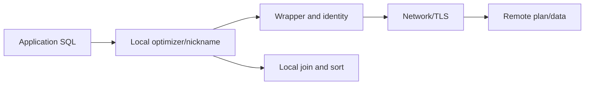

# I-05 — Federation, wrappers, servers, user mappings, nicknames, and pushdown diagnosis

**Procedure status: NOT YET EXECUTED.** This is a teaching procedure for Db2 LUW 12.1.0 on Linux x86-64, single-member topology. The exact fix pack is not pinned. Engine commands run on the Db2 server as the named instance/database authority; client checks run on the client; OS commands run on the named host and normally require read-only access. Windows, AIX, DPF, and pureScale differences are called out where material. The supplied environment has no Db2 CLI or disposable Db2 server, so no lab command is claimed as executed. Before production use, confirm each command against the installed fix pack and local change controls.

## 1. Quick answer

Use this lesson to make a bounded decision about wrapper/server/user mapping/nickname, remote credentials and least privilege, pushdown and remote plan. Confirm target, authority, state, and recovery boundary before changing anything.

**Safest first step:** Capture the exact target, release, role, timestamp, and read-only state before acting.

## 2. Learn the concept

Follow wrapper/server/user mapping/nickname; remote credentials and least privilege; pushdown and remote plan; network/TLS and remote failure; remote source support; federation versus local copy across the service boundary. Each stage has its own owner and evidence; a successful command is not proof of the business outcome.

### Working model

Decision path: wrapper/server/user mapping/nickname → remote credentials and least privilege → pushdown and remote plan → network/TLS and remote failure → remote source support → federation versus local copy. The arrows are dependencies to verify, not proof of causality.



## 3. Choose an approach

| Variant | Choose it when | Do not choose it when / boundary |
|---|---|---|
| Federated read | Query supported remote source through wrapper and nickname. | Remote latency and estimates affect local work. |
| Write-through | Use only for documented operations and tested transaction behavior. | Do not assume all sources share Db2 semantics. |
| Local copy/replication | Choose for bounded latency, availability, or historical snapshots. | Adds freshness and reconciliation duties. |

## 4. Understand the lifecycle

- Confirm source wrapper and supported release.
- Create least-privilege remote identity and protected mapping.
- Register server, test connection, define nickname and statistics.
- Explain query and verify predicate pushdown and remote plan.
- Monitor remote latency/errors and define fallback/timeout.
- Reassess against local replication or ETL needs.

**Pause/retry/stop/rollback rule:** Stop if target identity, role, authority, prerequisites, data-loss decision, or rollback path is uncertain; preserve evidence and escalate.

## 5. Do the work

### Precheck

- Verify feature entitlement and wrapper support.
- Keep password out of scripts, command history, logs, and examples.
- Agree TLS, endpoint, timeout, remote account, and data classification.

### Scoped procedures

### Procedure 1: Inventory server/nickname

**Status:** NOT YET EXECUTED. **Run as:** Catalog reader. **Target:** Federation catalog. **Authority/prerequisite:** Confirm catalog columns and privileges on installed fix pack; mask sensitive endpoint options.

```bash
SELECT servername, wrappername FROM syscat.servers; SELECT nickname, remote_schema, remote_table FROM syscat.nicknames
```

**Expected result:** Registered server and nickname names are listed.

**Independent check:** Compare with source owner and test mapped-user connectivity.

**Stop/rollback boundary:** Read-only.

### Procedure 2: Explain nickname query

**Status:** NOT YET EXECUTED. **Run as:** Query owner. **Target:** Read-only nickname query. **Authority/prerequisite:** Use supported explain setup and remote explain privileges.

```bash
EXPLAIN PLAN FOR SELECT CUSTOMER_ID FROM APP.REMOTE_CUSTOMER WHERE CUSTOMER_ID = 42
```

**Expected result:** Plan is recorded if the wrapper supports explain.

**Independent check:** Inspect remote SQL/predicate pushdown and source-side plan.

**Stop/rollback boundary:** Read-only; clear only owned explain rows through approved housekeeping.

## 6. Worked example and verification

If a nickname query is slow while local health is normal, check pushdown, remote statistics, network time, and source plan before increasing local memory.

**Expected state/result:** Federated access has supported wrapper, protected identity, bounded workload, measured pushdown, timeout behavior, owner, and fallback decision.

**Independent verification:**

- Compare pre-state and post-state from independent evidence.
- Validate the affected application or business transaction, not only the Db2 return code.

## 7. Diagnose problems

| Symptom or verified error | Evidence to collect | Likely cause | Safe correction and recheck | Avoid |
|---|---|---|---|---|
| Remote connection timeout | SQLCODE/SQLSTATE, db2diag, masked options, network/TLS and source logs | DNS, firewall, TLS, mapping, remote outage, or timeout mismatch | test each boundary as mapped identity; bound retry behavior | put passwords in ad hoc DDL or loop retries |
| Large remote scan | explain output, remote SQL, nickname statistics, rows transferred, source plan | predicate not pushed or statistics/type mismatch | adjust supported query shape and refresh stats, then verify source plan | assume local estimates prove remote cost |

## 8. Practice

On two disposable databases, create read-only mapping and nickname, compare pushed query with non-pushed query, simulate outage, then remove isolated objects. No federation lab; NOT YET EXECUTED.

## 9. Check understanding

**Question:** When should data be copied locally instead of queried remotely?

**Answer and reasoning:** When latency, availability, remote load, freshness, or transaction requirements cannot be met by federation.

## 10. Look it up later

### Short checklist

- Name the host, instance, database, member, and role.
- Capture baseline and confirm prerequisites.
- Choose the supported and least disruptive branch.
- Verify state and service behavior independently.
- Record evidence, owner, and recovery boundary.

### Related lessons

[B-01](../B/B-01.md) · [D-04](../D/D-04.md) · [E-03](../E/E-03.md) · [H-01](../H/H-01.md) · [K-04](../K/K-04.md)

### Authoritative references

- [IBM configuring access to Db2 data sources](https://www.ibm.com/docs/en/db2/12.1.x?topic=wrapper-configuring-access-db2-data-sources)
- [IBM federation pushdown analysis](https://www.ibm.com/docs/en/db2/12.1.x?topic=phases-federated-database-pushdown-analysis)
- [IBM federation database options](https://www.ibm.com/docs/en/db2/12.1.x?topic=options-database)

---

[Domain index](README.md) · [Course index](../README.md) · [Glossary](../GLOSSARY.md)
