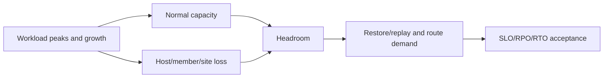

# I-06 — Capacity planning and reference architectures with recovery/failover headroom

**Procedure status: NOT YET EXECUTED.** This is a teaching procedure for Db2 LUW 12.1.0 on Linux x86-64, single-member topology. The exact fix pack is not pinned. Engine commands run on the Db2 server as the named instance/database authority; client checks run on the client; OS commands run on the named host and normally require read-only access. Windows, AIX, DPF, and pureScale differences are called out where material. The supplied environment has no Db2 CLI or disposable Db2 server, so no lab command is claimed as executed. Before production use, confirm each command against the installed fix pack and local change controls.

## 1. Quick answer

Use this lesson to make a bounded decision about transaction demand and growth assumptions, CPU/memory/storage/network sizing, HA/DR and backup load during failure. Confirm target, authority, state, and recovery boundary before changing anything.

**Safest first step:** Capture the exact target, release, role, timestamp, and read-only state before acting.

## 2. Learn the concept

Follow transaction demand and growth assumptions; CPU/memory/storage/network sizing; HA/DR and backup load during failure; N+1 and site-loss headroom; SLO/RPO/RTO fit; reference-architecture trade-offs across the service boundary. Each stage has its own owner and evidence; a successful command is not proof of the business outcome.

### Working model

Decision path: transaction demand and growth assumptions → CPU/memory/storage/network sizing → HA/DR and backup load during failure → N+1 and site-loss headroom → SLO/RPO/RTO fit → reference-architecture trade-offs. The arrows are dependencies to verify, not proof of causality.



## 3. Choose an approach

| Variant | Choose it when | Do not choose it when / boundary |
|---|---|---|
| Single-site HA | Size survivor for peak service after host/member loss. | Average normal load is not a failure-mode plan. |
| Site DR | Include remote capacity, replay, client route, keys, and validation. | A warm standby must meet recovery objectives. |
| DPF/pureScale | Model partition skew and member/CF loss separately. | Aggregate capacity can hide one exhausted unit. |

## 4. Understand the lifecycle

- Define workload, concurrency, peak, growth, SLO, RPO, and RTO.
- Measure CPU, memory, I/O, network, logs, and batch overlap.
- Model host/member/storage/site loss and recovery contention.
- Select topology and reserve survivor headroom.
- Load-test normal and degraded modes; measure service end-to-end.
- Review growth assumptions and retest at agreed interval.

**Pause/retry/stop/rollback rule:** Stop if target identity, role, authority, prerequisites, data-loss decision, or rollback path is uncertain; preserve evidence and escalate.

## 5. Do the work

### Precheck

- Use per-member percentiles and representative peaks, not only averages.
- Include backup, restore throughput, log replay, and key/network dependency.
- Record units, uncertainty, horizon, and acceptance.

### Scoped procedures

### Procedure 1: Member workload counters

**Status:** NOT YET EXECUTED. **Run as:** Monitoring identity. **Target:** Each active database member. **Authority/prerequisite:** Confirm release-specific columns and collect at bounded interval.

```bash
SELECT MEMBER, TOTAL_APP_COMMITS, TOTAL_APP_RQSTS, TOTAL_CPU_TIME FROM TABLE(MON_GET_DATABASE(-2)) AS M
```

**Expected result:** Per-member workload counters are returned.

**Independent check:** Calculate interval deltas and compare with OS/storage/app metrics.

**Stop/rollback boundary:** Read-only.

### Procedure 2: Capacity snapshot

**Status:** NOT YET EXECUTED. **Run as:** Linux host operator. **Target:** Actual Db2 data/log/archive mounts. **Authority/prerequisite:** Map actual containers/archive paths; quotas and object storage need separate checks.

```bash
df -hP /db2data /db2log /db2archive; df -iP /db2data /db2log /db2archive
```

**Expected result:** Current blocks and inodes are displayed.

**Independent check:** Compare dated trends, growth assumptions, and recovery demand.

**Stop/rollback boundary:** Read-only; expansion follows platform change plan.

## 6. Worked example and verification

If an HADR site serves all traffic after failover, size it for peak workload plus replay and backup demand, not primary average utilization.

**Expected state/result:** Architecture records demand assumptions, failure scenarios, survivor headroom, measured SLO/RPO/RTO fit, dependencies, and retest trigger.

**Independent verification:**

- Compare pre-state and post-state from independent evidence.
- Validate the affected application or business transaction, not only the Db2 return code.

## 7. Diagnose problems

| Symptom or verified error | Evidence to collect | Likely cause | Safe correction and recheck | Avoid |
|---|---|---|---|---|
| Normal load fits, failover saturates | per-node demand, skew, replay, client routing, and app metrics | capacity modeled only for normal state | load-test loss scenarios and add capacity or explicitly reduce service tier | claim HA because a standby exists |
| Space exists but restore misses RTO | image size, media/network throughput, logs, and restore time | volume capacity mistaken for recovery throughput | measure full restore path and provision throughput | infer RTO from free-space amount |

## 8. Practice

Use synthetic demand/growth inputs to size primary, survivor, standby, backup window, and site-loss recovery. State uncertainties and acceptance tests. No benchmark environment; NOT YET EXECUTED.

## 9. Check understanding

**Question:** Why model degraded/failure modes in capacity planning?

**Answer and reasoning:** Failover, replay, backup, and recovery run when resources may already be reduced; normal-state headroom alone does not establish continuity.

## 10. Look it up later

### Short checklist

- Name the host, instance, database, member, and role.
- Capture baseline and confirm prerequisites.
- Choose the supported and least disruptive branch.
- Verify state and service behavior independently.
- Record evidence, owner, and recovery boundary.

### Related lessons

[A-01](../A/A-01.md) · [A-03](../A/A-03.md) · [A-04](../A/A-04.md) · [B-06](../B/B-06.md) · [F-03](../F/F-03.md) · [G-01](../G/G-01.md) · [J-06](../J/J-06.md) · [K-04](../K/K-04.md)

### Authoritative references

- [IBM monitoring interfaces](https://www.ibm.com/docs/en/db2/12.1.x?topic=monitoring-interfaces-database)
- [IBM HADR configuration](https://www.ibm.com/docs/en/db2/12.1.x?topic=hadr-database-configuration)
- [IBM backup](https://www.ibm.com/docs/en/db2/12.1.x?topic=commands-backup-database)

---

[Domain index](README.md) · [Course index](../README.md) · [Glossary](../GLOSSARY.md)
