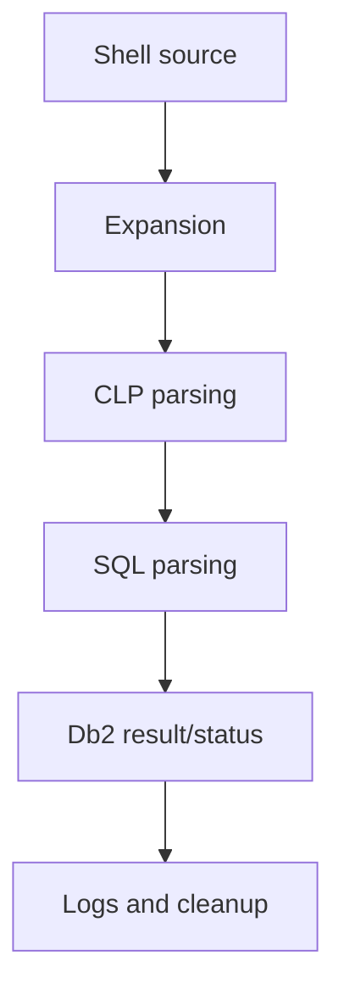

# J-01 — Bash and ksh for Db2: quoting, environment, exit codes, signals, and secrets

**Procedure status: NOT YET EXECUTED.** This is a teaching procedure for Db2 LUW 12.1.0 on Linux x86-64, single-member topology. The exact fix pack is not pinned. Engine commands run on the Db2 server as the named instance/database authority; client checks run on the client; OS commands run on the named host and normally require read-only access. Windows, AIX, DPF, and pureScale differences are called out where material. The supplied environment has no Db2 CLI or disposable Db2 server, so no lab command is claimed as executed. Before production use, confirm each command against the installed fix pack and local change controls.

## 1. Quick answer

Use this lesson to make a bounded decision about shell quoting and expansion, DB2INSTANCE/profile/PATH, CLP and SQL terminators. Confirm target, authority, state, and recovery boundary before changing anything.

**Safest first step:** Capture the exact target, release, role, timestamp, and read-only state before acting.

## 2. Learn the concept

Follow shell quoting and expansion; DB2INSTANCE/profile/PATH; CLP and SQL terminators; exit status and pipelines; signals and temporary cleanup; secret handling across the service boundary. Each stage has its own owner and evidence; a successful command is not proof of the business outcome.

### Working model

Decision path: shell quoting and expansion → DB2INSTANCE/profile/PATH → CLP and SQL terminators → exit status and pipelines → signals and temporary cleanup → secret handling. The arrows are dependencies to verify, not proof of causality.



## 3. Choose an approach

| Variant | Choose it when | Do not choose it when / boundary |
|---|---|---|
| Bash | Use explicit quoting and preserve pipeline status. | Do not assume Bash syntax works in ksh/POSIX sh. |
| ksh | Use the host-supported KornShell version. | Validate version-specific arrays and traps. |
| SQL input | Use reviewed files or deliberate CLP terminators. | Shell and CLP are separate parsers. |

## 4. Understand the lifecycle

- Pin supported interpreter.
- Set Db2 environment and source intended profile.
- Separate shell, CLP, and SQL quoting.
- Capture command status including pipeline failures.
- Trap signals for safe temporary cleanup.
- Use protected secret references, not source/args/history.

**Pause/retry/stop/rollback rule:** Stop if target identity, role, authority, prerequisites, data-loss decision, or rollback path is uncertain; preserve evidence and escalate.

## 5. Do the work

### Precheck

- Record shell version, Db2 copy, instance, locale, and working directory.
- Never include passwords/private keys in source, args, history, or logs.
- Use synthetic database and test data.

### Scoped procedures

### Procedure 1: Assert environment and code

**Status:** NOT YET EXECUTED. **Run as:** Instance owner/script account. **Target:** Named host and instance. **Authority/prerequisite:** Illustrative Bash syntax; validate the actual target shell and profile.

```bash
set -euo pipefail; export DB2INSTANCE=db2inst1; . ~db2inst1/sqllib/db2profile; printf "instance=%s\n" "$DB2INSTANCE"; db2level
```

**Expected result:** Script reports target instance and Db2 level or fails.

**Independent check:** Confirm expected copy and ensure no secret is printed.

**Stop/rollback boundary:** Read-only; handle expected nonzero statuses explicitly.

### Procedure 2: Run reviewed SQL file

**Status:** NOT YET EXECUTED. **Run as:** Query account. **Target:** Approved nonproduction database. **Authority/prerequisite:** Reviewed file uses explicit terminator and no credentials or concatenated user SQL.

```bash
db2 -tvf /opt/dbatools/health.sql
```

**Expected result:** CLP runs statements and returns status.

**Independent check:** Inspect every result and query expected server identity.

**Stop/rollback boundary:** Keep collector read-only; do not put mutations in generic check file.

## 6. Worked example and verification

The shell expands variables and quotes before CLP sees SQL. A reviewed file with explicit terminator avoids nested quoting and is easier to inspect.

**Expected state/result:** Script pins interpreter/environment, preserves nonzero status, handles interruption, passes values safely, and contains no credentials.

**Independent verification:**

- Compare pre-state and post-state from independent evidence.
- Validate the affected application or business transaction, not only the Db2 return code.

## 7. Diagnose problems

| Symptom or verified error | Evidence to collect | Likely cause | Safe correction and recheck | Avoid |
|---|---|---|---|---|
| Wrong instance reached | DB2INSTANCE, PATH, DB2DIR, profile, and db2level | scheduler loaded different environment | assert target and level before connecting | rely on interactive shell state |
| Pipeline hides Db2 error | pipeline status and pipefail behavior | only last pipeline status was checked | enable pipefail and capture Db2 status explicitly | trust last shell status after logger pipeline |

## 8. Practice

Create Bash and ksh variants for one read-only query; preserve status through a logging pipeline and clean temporary files on INT/TERM. No Db2 host; NOT YET EXECUTED.

## 9. Check understanding

**Question:** Why can shell quoting break valid SQL?

**Answer and reasoning:** The shell processes quotes and substitutions before CLP/SQL parsing; each parser layer must receive the intended text.

## 10. Look it up later

### Short checklist

- Name the host, instance, database, member, and role.
- Capture baseline and confirm prerequisites.
- Choose the supported and least disruptive branch.
- Verify state and service behavior independently.
- Record evidence, owner, and recovery boundary.

### Related lessons

[A-02](../A/A-02.md) · [B-04](../B/B-04.md) · [J-02](../J/J-02.md) · [J-04](../J/J-04.md)

### Authoritative references

- [GNU Bash manual](https://www.gnu.org/software/bash/manual/bash.html)
- [KornShell documentation](https://github.com/ksh93/ksh)

---

[Domain index](README.md) · [Course index](../README.md) · [Glossary](../GLOSSARY.md)
