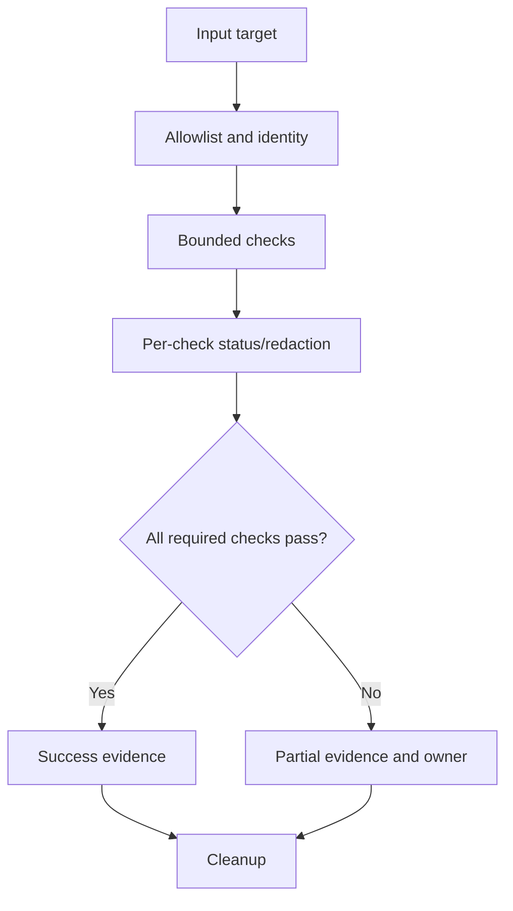

# J-02 — Safe shell runbooks and bounded evidence collectors

**Procedure status: NOT YET EXECUTED.** This is a teaching procedure for Db2 LUW 12.1.0 on Linux x86-64, single-member topology. The exact fix pack is not pinned. Engine commands run on the Db2 server as the named instance/database authority; client checks run on the client; OS commands run on the named host and normally require read-only access. Windows, AIX, DPF, and pureScale differences are called out where material. The supplied environment has no Db2 CLI or disposable Db2 server, so no lab command is claimed as executed. Before production use, confirm each command against the installed fix pack and local change controls.

## 1. Quick answer

Use this lesson to make a bounded decision about allowlisted targets, read-only collection boundaries, timeout and partial failure. Confirm target, authority, state, and recovery boundary before changing anything.

**Safest first step:** Capture the exact target, release, role, timestamp, and read-only state before acting.

## 2. Learn the concept

Follow allowlisted targets; read-only collection boundaries; timeout and partial failure; per-command status; redaction and retention; cleanup and re-entry across the service boundary. Each stage has its own owner and evidence; a successful command is not proof of the business outcome.

### Working model

Decision path: allowlisted targets → read-only collection boundaries → timeout and partial failure → per-command status → redaction and retention → cleanup and re-entry. The arrows are dependencies to verify, not proof of causality.



## 3. Choose an approach

| Variant | Choose it when | Do not choose it when / boundary |
|---|---|---|
| Collector | Gather bounded evidence and report partial results. | Do not silently succeed after one check fails. |
| Runbook action | Require target confirmation and approval gate. | Separate inspection from mutation. |
| Multi-host collection | Limit concurrency and identify missing hosts. | Do not hide unreachable members. |

## 4. Understand the lifecycle

- Validate input against target allowlist.
- Assert host, instance, database, and role.
- Run each check with timeout and isolated status.
- Redact sensitive output and record timestamp.
- Return partial/fail status with per-target evidence.
- Clean temporary files and allow safe rerun.

**Pause/retry/stop/rollback rule:** Stop if target identity, role, authority, prerequisites, data-loss decision, or rollback path is uncertain; preserve evidence and escalate.

## 5. Do the work

### Precheck

- Use least-privilege identity and restricted output directory.
- Set collection, disk, retention, and concurrency limits.
- Do not collect SQL literals, credentials, or customer rows.

### Scoped procedures

### Procedure 1: Bounded collector sketch

**Status:** NOT YET EXECUTED. **Run as:** Automation account. **Target:** One allowlisted nonproduction target. **Authority/prerequisite:** Illustrative; use secure temp directory, unique run ID, trap cleanup, profile assertion, and redaction.

```bash
TARGET="$1"; case "$TARGET" in SAMPLE_QA) ;; *) exit 64;; esac; timeout 15 db2 connect to "$TARGET"; rc=$?; timeout 15 db2pd -db "$TARGET" -alldbs; pd_rc=$?; exit $((rc || pd_rc))
```

**Expected result:** Commands have bounded runtime and explicit status.

**Independent check:** Inspect each output and status; overall exit is nonzero if a required check fails.

**Stop/rollback boundary:** Read-only checks; preserve evidence under incident retention.

### Procedure 2: DPF bounded host check

**Status:** NOT YET EXECUTED. **Run as:** Instance owner. **Target:** Configured DPF hosts only. **Authority/prerequisite:** Use only where DPF exists; validate db2nodes.cfg and cap fan-out.

```bash
db2_all "hostname"
```

**Expected result:** Per-host output returns where reachable.

**Independent check:** Compare returned hosts with expected list; report missing nodes.

**Stop/rollback boundary:** Read-only; do not fan out state changes by default.

## 6. Worked example and verification

If a collector cannot reach one partition, report it as missing and return partial/failure. An empty aggregate must never mean all hosts are healthy.

**Expected state/result:** Runbook proves allowlisted target, captures per-step status, enforces timeout/concurrency, redacts output, and cleans safely.

**Independent verification:**

- Compare pre-state and post-state from independent evidence.
- Validate the affected application or business transaction, not only the Db2 return code.

## 7. Diagnose problems

| Symptom or verified error | Evidence to collect | Likely cause | Safe correction and recheck | Avoid |
|---|---|---|---|---|
| Collector reports success with missing host | expected host list, per-host status, timeout, and aggregate exit status | pipeline/loop discarded partial failure | return per-target status and compare completeness | use only the last command status |
| Collector hangs or fills disk | process tree, timeout, output size, utility state, filesystem | unbounded command or retry | bound execution/output and inspect Db2 state before retry | kill Db2 to stop a collector |

## 8. Practice

Build a collector for three synthetic hosts with one unreachable target and one timeout; verify partial status, redaction, output bounds, and cleanup. No cluster; NOT YET EXECUTED.

## 9. Check understanding

**Question:** What makes a collector safe to rerun?

**Answer and reasoning:** It is read-only or checks desired state, uses unique bounded output, avoids duplicate work, and reports incomplete prior runs.

## 10. Look it up later

### Short checklist

- Name the host, instance, database, member, and role.
- Capture baseline and confirm prerequisites.
- Choose the supported and least disruptive branch.
- Verify state and service behavior independently.
- Record evidence, owner, and recovery boundary.

### Related lessons

[A-02](../A/A-02.md) · [J-01](../J/J-01.md) · [J-04](../J/J-04.md) · [J-06](../J/J-06.md) · [K-01](../K/K-01.md)

### Authoritative references

- [GNU Bash manual](https://www.gnu.org/software/bash/manual/bash.html)
- [IBM monitoring interfaces](https://www.ibm.com/docs/en/db2/12.1.x?topic=monitoring-interfaces-database)
- [IBM diagnostic log](https://www.ibm.com/docs/en/db2/12.1.x?topic=files-interpreting-diagnostic-log-file-entries)

---

[Domain index](README.md) · [Course index](../README.md) · [Glossary](../GLOSSARY.md)
