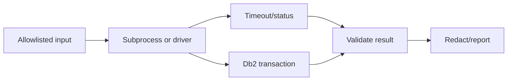

# J-03 — Python automation: subprocesses, drivers/CLI, timeouts, parsing, and secrets

**Procedure status: NOT YET EXECUTED.** This is a teaching procedure for Db2 LUW 12.1.0 on Linux x86-64, single-member topology. The exact fix pack is not pinned. Engine commands run on the Db2 server as the named instance/database authority; client checks run on the client; OS commands run on the named host and normally require read-only access. Windows, AIX, DPF, and pureScale differences are called out where material. The supplied environment has no Db2 CLI or disposable Db2 server, so no lab command is claimed as executed. Before production use, confirm each command against the installed fix pack and local change controls.

## 1. Quick answer

Use this lesson to make a bounded decision about subprocess argument arrays and status, Db2 CLP versus Python driver, timeout and child cleanup. Confirm target, authority, state, and recovery boundary before changing anything.

**Safest first step:** Capture the exact target, release, role, timestamp, and read-only state before acting.

## 2. Learn the concept

Follow subprocess argument arrays and status; Db2 CLP versus Python driver; timeout and child cleanup; structured result parsing; secret injection and redaction; connection/transaction handling across the service boundary. Each stage has its own owner and evidence; a successful command is not proof of the business outcome.

### Working model

Decision path: subprocess argument arrays and status → Db2 CLP versus Python driver → timeout and child cleanup → structured result parsing → secret injection and redaction → connection/transaction handling. The arrows are dependencies to verify, not proof of causality.



## 3. Choose an approach

| Variant | Choose it when | Do not choose it when / boundary |
|---|---|---|
| Subprocess CLI | Use argument arrays for bounded existing utilities. | Never build shell command from external input. |
| Python driver | Use supported driver and parameterized SQL. | Pin compatibility and transaction semantics. |
| Read-only report | Parse explicit structured output and preserve provenance. | Nonempty stdout does not prove success. |

## 4. Understand the lifecycle

- Select supported Python and Db2 client/driver.
- Validate target and obtain secret from approved provider.
- Execute with argument list, timeout, and captured status/output.
- Parse explicit result format and handle malformed/partial output.
- Use parameterized SQL and explicit transaction boundary.
- Redact, close resources, and report per-target result.

**Pause/retry/stop/rollback rule:** Stop if target identity, role, authority, prerequisites, data-loss decision, or rollback path is uncertain; preserve evidence and escalate.

## 5. Do the work

### Precheck

- Check current IBM driver compatibility and TLS setup.
- Set connection/query timeouts; protect secrets from exceptions/logs.
- Test interruption, timeout, reconnect, and partial results.

### Scoped procedures

### Procedure 1: Bounded subprocess example

**Status:** NOT YET EXECUTED. **Run as:** Automation identity. **Target:** Configured nonproduction connection. **Authority/prerequisite:** Illustrative fixed query; validate environment and redact errors.

```bash
python3 -c "import subprocess; p=subprocess.run(["db2","-x","select current server from sysibm.sysdummy1"],capture_output=True,text=True,timeout=20,check=False); print(p.stdout); raise SystemExit(p.returncode)"
```

**Expected result:** Python captures output/status; timeout raises an exception.

**Independent check:** Check server identity, expected row, stderr, and elapsed time.

**Stop/rollback boundary:** Read-only; after timeout check whether server-side work continues.

### Procedure 2: Parameterized driver query

**Status:** NOT YET EXECUTED. **Run as:** Automation/query account. **Target:** Approved test schema. **Authority/prerequisite:** Use supported IBM Db2 driver, TLS, least privilege, parameter binding, and timeout.

```python
cursor.execute("SELECT COUNT(*) FROM APP.TEST_TABLE WHERE STATUS = ?", (status,))
```

**Expected result:** One parameterized result is returned.

**Independent check:** Validate result type/value and close cursor/connection; rollback open transaction on exception.

**Stop/rollback boundary:** Read-only SQL; rollback open transaction on failure.

## 6. Worked example and verification

Use an argument list so shell metacharacters are not expanded. For variable data use driver parameter binding rather than SQL string concatenation.

**Expected state/result:** Automation has pinned runtime/driver, bounded subprocess/query, validated result, protected secret path, redaction, and transaction cleanup.

**Independent verification:**

- Compare pre-state and post-state from independent evidence.
- Validate the affected application or business transaction, not only the Db2 return code.

## 7. Diagnose problems

| Symptom or verified error | Evidence to collect | Likely cause | Safe correction and recheck | Avoid |
|---|---|---|---|---|
| Timeout leaves action ambiguous | timeout location, child PID, Db2 utility/activity status, target postcondition | client lost response after server accepted action | inspect server-side operation before deciding retry | retry non-idempotent work after any exception |
| Parser accepts malformed output | encoding, truncation, stderr, exit code, required fields | stdout treated as success proof | validate status, schema, row count, and fields | parse human-formatted output without version tests |

## 8. Practice

Write a Python read-only collector using subprocess and a supported driver; inject timeout, malformed output, missing credential, and SQL error. No Db2 connection; NOT YET EXECUTED.

## 9. Check understanding

**Question:** When should automation use subprocess versus a driver?

**Answer and reasoning:** Use subprocess for bounded existing utilities with fixed arguments; use a driver for parameterized SQL, structured rows, and transaction control.

## 10. Look it up later

### Short checklist

- Name the host, instance, database, member, and role.
- Capture baseline and confirm prerequisites.
- Choose the supported and least disruptive branch.
- Verify state and service behavior independently.
- Record evidence, owner, and recovery boundary.

### Related lessons

[B-04](../B/B-04.md) · [D-03](../D/D-03.md) · [J-01](../J/J-01.md) · [J-04](../J/J-04.md) · [J-06](../J/J-06.md)

### Authoritative references

- [Python subprocess documentation](https://docs.python.org/3/library/subprocess.html)
- [Python DB API 2.0](https://peps.python.org/pep-0249/)

---

[Domain index](README.md) · [Course index](../README.md) · [Glossary](../GLOSSARY.md)
