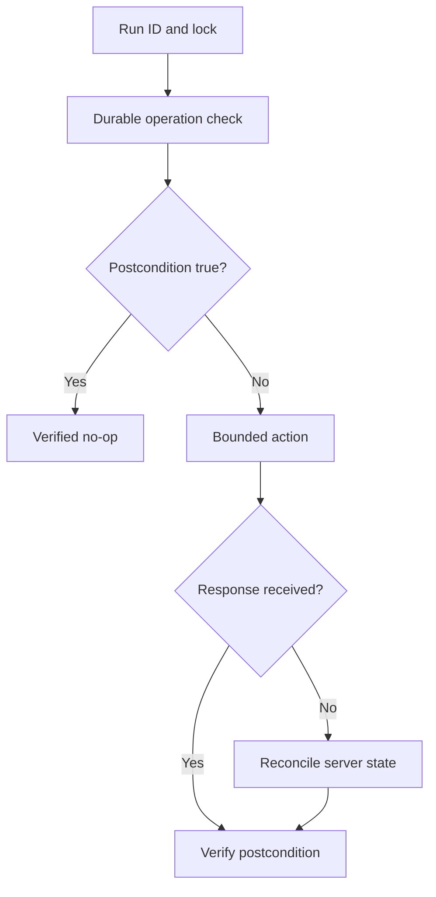

# J-04 — Testable, idempotent administrative automation and ambiguous timeouts

**Procedure status: NOT YET EXECUTED.** This is a teaching procedure for Db2 LUW 12.1.0 on Linux x86-64, single-member topology. The exact fix pack is not pinned. Engine commands run on the Db2 server as the named instance/database authority; client checks run on the client; OS commands run on the named host and normally require read-only access. Windows, AIX, DPF, and pureScale differences are called out where material. The supplied environment has no Db2 CLI or disposable Db2 server, so no lab command is claimed as executed. Before production use, confirm each command against the installed fix pack and local change controls.

## 1. Quick answer

Use this lesson to make a bounded decision about desired-state check, idempotent versus one-shot action, run ID and operation record. Confirm target, authority, state, and recovery boundary before changing anything.

**Safest first step:** Capture the exact target, release, role, timestamp, and read-only state before acting.

## 2. Learn the concept

Follow desired-state check; idempotent versus one-shot action; run ID and operation record; target lock; ambiguous timeout recovery; postcondition and rollback across the service boundary. Each stage has its own owner and evidence; a successful command is not proof of the business outcome.

### Working model

Decision path: desired-state check → idempotent versus one-shot action → run ID and operation record → target lock → ambiguous timeout recovery → postcondition and rollback. The arrows are dependencies to verify, not proof of causality.



## 3. Choose an approach

| Variant | Choose it when | Do not choose it when / boundary |
|---|---|---|
| Read-only check | Repeat within monitoring budget. | Verify overhead and output privacy. |
| Idempotent action | Check desired state before applying. | Repeat only when utility semantics permit it. |
| Non-idempotent action | Require request ID, approval, and state reconciliation. | Timeout is not proof of failure. |

## 4. Understand the lifecycle

- Define target, desired state, and precondition.
- Assign unique run ID and lock target.
- Check prior operation and current postcondition.
- Apply only if no completed/active operation exists.
- Verify postcondition independently.
- Record result; escalate ambiguous status rather than blind retry.

**Pause/retry/stop/rollback rule:** Stop if target identity, role, authority, prerequisites, data-loss decision, or rollback path is uncertain; preserve evidence and escalate.

## 5. Do the work

### Precheck

- Capture authority, target, utility/history state, and schedule overlap.
- Plan for lost client session after server accepts the action.
- Keep durable operation record outside process memory.

### Scoped procedures

### Procedure 1: Inspect before backup retry

**Status:** NOT YET EXECUTED. **Run as:** Instance owner/operator. **Target:** SAMPLE utility and backup history. **Authority/prerequisite:** Read-only; verify exact release syntax and target instance.

```bash
db2 list utilities show detail; db2 list history backup all for SAMPLE
```

**Expected result:** Active utility and backup entries are displayed.

**Independent check:** Compare run ID/time/image identity and database post-state.

**Stop/rollback boundary:** Read-only.

### Procedure 2: Inspect desired configuration

**Status:** NOT YET EXECUTED. **Run as:** Automation identity. **Target:** SAMPLE database. **Authority/prerequisite:** Read before action; update only when observed value differs from approved target.

```bash
db2 get db cfg for SAMPLE
```

**Expected result:** Current value is returned.

**Independent check:** After approved update, requery effective value and separately verify service.

**Stop/rollback boundary:** Use previous value only through reviewed rollback; do not overwrite unknown drift.

## 6. Worked example and verification

If a backup client times out after Db2 may have completed, inspect utility/history and image identity before deciding whether another backup is safe.

**Expected state/result:** Duplicate run is a verified no-op; ambiguous action stops for reconciliation and does not issue blind retry.

**Independent verification:**

- Compare pre-state and post-state from independent evidence.
- Validate the affected application or business transaction, not only the Db2 return code.

## 7. Diagnose problems

| Symptom or verified error | Evidence to collect | Likely cause | Safe correction and recheck | Avoid |
|---|---|---|---|---|
| Duplicate administrative action | run ID, utility history/status, lock owner, current state | retry ignored prior completed operation | serialize by target and reconcile postcondition | retry every nonzero client return |
| Stale lock blocks future work | lock owner PID/host/start time, lease, active Db2 operation | process ended while server action may still run | expire only after proving no server-side operation remains | remove lock automatically without target check |

## 8. Practice

Simulate response loss after a synthetic backup completes. Rerun and verify it sees the completed image; test stale lock and concurrency. No Db2 runtime; NOT YET EXECUTED.

## 9. Check understanding

**Question:** What should automation do when it cannot know whether Db2 accepted an action?

**Answer and reasoning:** Stop retrying, retain run ID, query server-side status/history and postcondition, then proceed only when safe state is proven.

## 10. Look it up later

### Short checklist

- Name the host, instance, database, member, and role.
- Capture baseline and confirm prerequisites.
- Choose the supported and least disruptive branch.
- Verify state and service behavior independently.
- Record evidence, owner, and recovery boundary.

### Related lessons

[J-01](../J/J-01.md) · [J-02](../J/J-02.md) · [J-03](../J/J-03.md) · [J-06](../J/J-06.md) · [K-01](../K/K-01.md)

### Authoritative references

- [IBM BACKUP DATABASE](https://www.ibm.com/docs/en/db2/12.1.x?topic=commands-backup-database)
- [IBM monitoring interfaces](https://www.ibm.com/docs/en/db2/12.1.x?topic=monitoring-interfaces-database)

---

[Domain index](README.md) · [Course index](../README.md) · [Glossary](../GLOSSARY.md)
