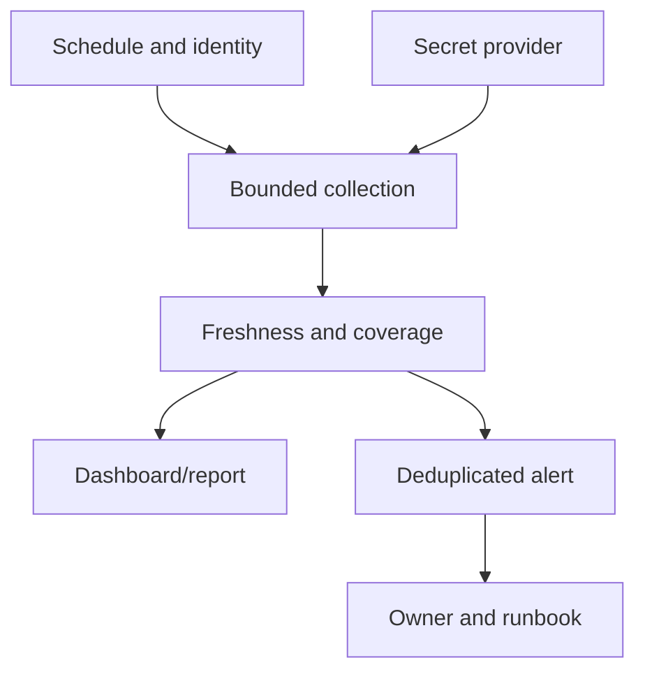

# J-05 — Scheduling, alerting, dashboards, credentials, retries, and operational reports

**Procedure status: NOT YET EXECUTED.** This is a teaching procedure for Db2 LUW 12.1.0 on Linux x86-64, single-member topology. The exact fix pack is not pinned. Engine commands run on the Db2 server as the named instance/database authority; client checks run on the client; OS commands run on the named host and normally require read-only access. Windows, AIX, DPF, and pureScale differences are called out where material. The supplied environment has no Db2 CLI or disposable Db2 server, so no lab command is claimed as executed. Before production use, confirm each command against the installed fix pack and local change controls.

## 1. Quick answer

Use this lesson to make a bounded decision about scheduler environment and identity, alert threshold and ownership, dashboard scope/freshness. Confirm target, authority, state, and recovery boundary before changing anything.

**Safest first step:** Capture the exact target, release, role, timestamp, and read-only state before acting.

## 2. Learn the concept

Follow scheduler environment and identity; alert threshold and ownership; dashboard scope/freshness; credential rotation; bounded retry and deduplication; report evidence and retention across the service boundary. Each stage has its own owner and evidence; a successful command is not proof of the business outcome.

### Working model

Decision path: scheduler environment and identity → alert threshold and ownership → dashboard scope/freshness → credential rotation → bounded retry and deduplication → report evidence and retention. The arrows are dependencies to verify, not proof of causality.



## 3. Choose an approach

| Variant | Choose it when | Do not choose it when / boundary |
|---|---|---|
| Scheduled collection | Pin profile, target, timezone, and interval. | Scheduler environment differs from interactive shell. |
| Alert/report | Show freshness, scope, and owner. | Stale green dashboard is not health proof. |
| Retry/credential failure | Bound retry and alert on rotation/connectivity. | Do not create retry storms or log secrets. |

## 4. Understand the lifecycle

- Select scheduler, timezone, and service identity.
- Set target allowlist and per-run status.
- Collect bounded metrics and test freshness.
- Route alert with dedup key and runbook.
- Rotate credentials through approved provider and test path.
- Review false alerts, missed pages, and retention.

**Pause/retry/stop/rollback rule:** Stop if target identity, role, authority, prerequisites, data-loss decision, or rollback path is uncertain; preserve evidence and escalate.

## 5. Do the work

### Precheck

- Synchronize clocks and document scheduler environment.
- Use secret references and least privilege.
- Set timeout, retry ceiling, backoff, jitter, and concurrency.

### Scoped procedures

### Procedure 1: Scheduled monitor sample

**Status:** NOT YET EXECUTED. **Run as:** Monitoring identity. **Target:** Named database/member aggregate. **Authority/prerequisite:** Validate release function/column support and scheduler profile.

```bash
db2 -x "SELECT CURRENT TIMESTAMP, MEMBER, TOTAL_APP_COMMITS FROM TABLE(MON_GET_DATABASE(-2)) AS M"
```

**Expected result:** Timestamped counters are returned.

**Independent check:** Check data age, member coverage, interval delta, and app SLO.

**Stop/rollback boundary:** Read-only.

### Procedure 2: Credential-free environment check

**Status:** NOT YET EXECUTED. **Run as:** Scheduler identity. **Target:** Selected host and Db2 copy. **Authority/prerequisite:** Run in scheduler context; do not print environment secrets.

```bash
test -r ~db2inst1/sqllib/db2profile && printf "profile readable\n"; db2level
```

**Expected result:** Profile check and code level are captured.

**Independent check:** Compare against approved install and secret-provider audit.

**Stop/rollback boundary:** Read-only.

## 6. Worked example and verification

A nightly report shows zero failures because collection stopped two hours earlier. Show last-success time and alert when data becomes stale.

**Expected state/result:** Schedules have owner/timezone, target, timeout, per-run status, alert route, secret rotation, freshness, deduplication, and retention.

**Independent verification:**

- Compare pre-state and post-state from independent evidence.
- Validate the affected application or business transaction, not only the Db2 return code.

## 7. Diagnose problems

| Symptom or verified error | Evidence to collect | Likely cause | Safe correction and recheck | Avoid |
|---|---|---|---|---|
| Job fails after credential rotation | secret version, expiry, auth method, scheduler logs, Db2 auth evidence | dependent service was not updated | test rotation end-to-end and alert before expiry | log secret or extend old credential indefinitely |
| Dashboard looks healthy with stale data | sample timestamp, collector status, row/member coverage | collector failure retained previous green state | show freshness and alert on missing samples | treat missing values as zero |
| Retries overload Db2 | retry count, interval, connection load, page history | immediate unbounded retry amplifies outage | cap retries, backoff/jitter, circuit-break, alert owner | retry every scheduler tick without limit |

## 8. Practice

Create a mock scheduled report with stale-data alert, fake credential rotation, backoff, dedup, and failure notification. No scheduler connected; NOT YET EXECUTED.

## 9. Check understanding

**Question:** How should a dashboard represent missing telemetry?

**Answer and reasoning:** As unknown/stale with last-success timestamp and an alert, never as zero load or healthy state.

## 10. Look it up later

### Short checklist

- Name the host, instance, database, member, and role.
- Capture baseline and confirm prerequisites.
- Choose the supported and least disruptive branch.
- Verify state and service behavior independently.
- Record evidence, owner, and recovery boundary.

### Related lessons

[E-02](../E/E-02.md) · [E-06](../E/E-06.md) · [J-01](../J/J-01.md) · [J-02](../J/J-02.md) · [J-04](../J/J-04.md) · [J-06](../J/J-06.md)

### Authoritative references

- [IBM monitoring interfaces](https://www.ibm.com/docs/en/db2/12.1.x?topic=monitoring-interfaces-database)
- [IBM MON routines](https://www.ibm.com/docs/en/db2/12.1.x?topic=functions-monitor-mon-routines)

---

[Domain index](README.md) · [Course index](../README.md) · [Glossary](../GLOSSARY.md)
