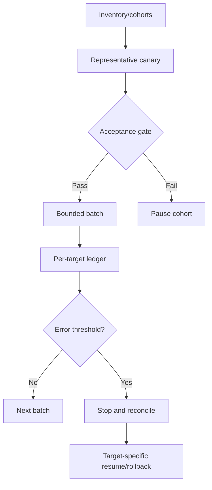

# J-06 — Fleet automation, canaries, concurrency limits, per-target results, and rollback

**Procedure status: NOT YET EXECUTED.** This is a teaching procedure for Db2 LUW 12.1.0 on Linux x86-64, single-member topology. The exact fix pack is not pinned. Engine commands run on the Db2 server as the named instance/database authority; client checks run on the client; OS commands run on the named host and normally require read-only access. Windows, AIX, DPF, and pureScale differences are called out where material. The supplied environment has no Db2 CLI or disposable Db2 server, so no lab command is claimed as executed. Before production use, confirm each command against the installed fix pack and local change controls.

## 1. Quick answer

Use this lesson to make a bounded decision about fleet inventory and allowlist, representative canary cohort, concurrency/rate limits. Confirm target, authority, state, and recovery boundary before changing anything.

**Safest first step:** Capture the exact target, release, role, timestamp, and read-only state before acting.

## 2. Learn the concept

Follow fleet inventory and allowlist; representative canary cohort; concurrency/rate limits; per-target outcome; partial failure and resume; target-specific rollback across the service boundary. Each stage has its own owner and evidence; a successful command is not proof of the business outcome.

### Working model

Decision path: fleet inventory and allowlist → representative canary cohort → concurrency/rate limits → per-target outcome → partial failure and resume → target-specific rollback. The arrows are dependencies to verify, not proof of causality.



## 3. Choose an approach

| Variant | Choose it when | Do not choose it when / boundary |
|---|---|---|
| Canary | Test a representative target and compare acceptance. | One easy target may not represent every topology. |
| Cohort rollout | Expand bounded batches after each gate. | Do not fan out everywhere at once. |
| Partial failure | Stop expansion; preserve successes/failures separately. | Fleet work is not all-or-nothing. |

## 4. Understand the lifecycle

- Inventory hosts, versions, and topologies.
- Choose canary for each meaningful cohort.
- Set concurrency, rate, timeout, and stop trigger.
- Record per-target pre/post state and result.
- Pause when failure threshold is met and inspect cohort.
- Resume or rollback only verified targets.

**Pause/retry/stop/rollback rule:** Stop if target identity, role, authority, prerequisites, data-loss decision, or rollback path is uncertain; preserve evidence and escalate.

## 5. Do the work

### Precheck

- Account for mixed OS, release, DPF, pureScale, and HADR differences.
- Approve and deduplicate target list; coordinate window.
- Design per-target rollback and durable run ledger.

### Scoped procedures

### Procedure 1: Preflight host inventory

**Status:** NOT YET EXECUTED. **Run as:** Fleet automation identity. **Target:** Approved DPF host list only. **Authority/prerequisite:** Use only on DPF; compare with expected inventory and cap concurrency.

```bash
db2_all "hostname; db2level"
```

**Expected result:** Per-host host and code level are returned where reachable.

**Independent check:** Report missing/unexpected hosts and versions individually.

**Stop/rollback boundary:** Read-only.

### Procedure 2: Bounded parallel preflight sketch

**Status:** NOT YET EXECUTED. **Run as:** Fleet operator. **Target:** At most two allowlisted targets. **Authority/prerequisite:** Validate host xargs support, quoting, per-target status, and target file first.

```bash
xargs -r -n 1 -P 2 /opt/dbatools/preflight_one_target.sh < targets.txt
```

**Expected result:** At most two preflight checks run at once.

**Independent check:** Compare result ledger with full target set; keep failures visible.

**Stop/rollback boundary:** Read-only preflight; rollout needs separate approval and target-level rollback.

## 6. Worked example and verification

Six Linux instances pass a fix-pack canary while a DPF readiness check fails. Pause the DPF cohort, retain successful results, and do not report whole-fleet success.

**Expected state/result:** Fleet report records each target/cohort, canary gate, status, skipped/failed reason, and safe resume/rollback state.

**Independent verification:**

- Compare pre-state and post-state from independent evidence.
- Validate the affected application or business transaction, not only the Db2 return code.

## 7. Diagnose problems

| Symptom or verified error | Evidence to collect | Likely cause | Safe correction and recheck | Avoid |
|---|---|---|---|---|
| Failed host is hidden | expected host list, per-target exit, canary, result ledger | parallel runner returned aggregate or last status only | persist a result per host and check completeness | declare success from parent process status alone |
| Rollout overloads storage | active operations, I/O queue, member skew, schedule overlap | parallelism ignored shared resource budget | reduce concurrency and resume after health gate | increase parallelism to force completion |

## 8. Practice

Simulate Linux/AIX/DPF/standalone targets with failed canary, unreachable host, and partial success. Test pause, report, resume, and target rollback. No fleet; NOT YET EXECUTED.

## 9. Check understanding

**Question:** Why calculate fleet success from a target ledger?

**Answer and reasoning:** Aggregate status can hide missing or failed hosts; per-target evidence proves completeness and recovery state.

## 10. Look it up later

### Short checklist

- Name the host, instance, database, member, and role.
- Capture baseline and confirm prerequisites.
- Choose the supported and least disruptive branch.
- Verify state and service behavior independently.
- Record evidence, owner, and recovery boundary.

### Related lessons

[I-02](../I/I-02.md) · [I-06](../I/I-06.md) · [J-01](../J/J-01.md) · [J-02](../J/J-02.md) · [J-04](../J/J-04.md) · [J-05](../J/J-05.md) · [K-03](../K/K-03.md)

### Authoritative references

- [IBM installFixPack](https://www.ibm.com/docs/en/db2/12.1.x?topic=commands-installfixpack-update-installed-db2-database-products)
- [IBM monitoring interfaces](https://www.ibm.com/docs/en/db2/12.1.x?topic=monitoring-interfaces-database)

---

[Domain index](README.md) · [Course index](../README.md) · [Glossary](../GLOSSARY.md)
