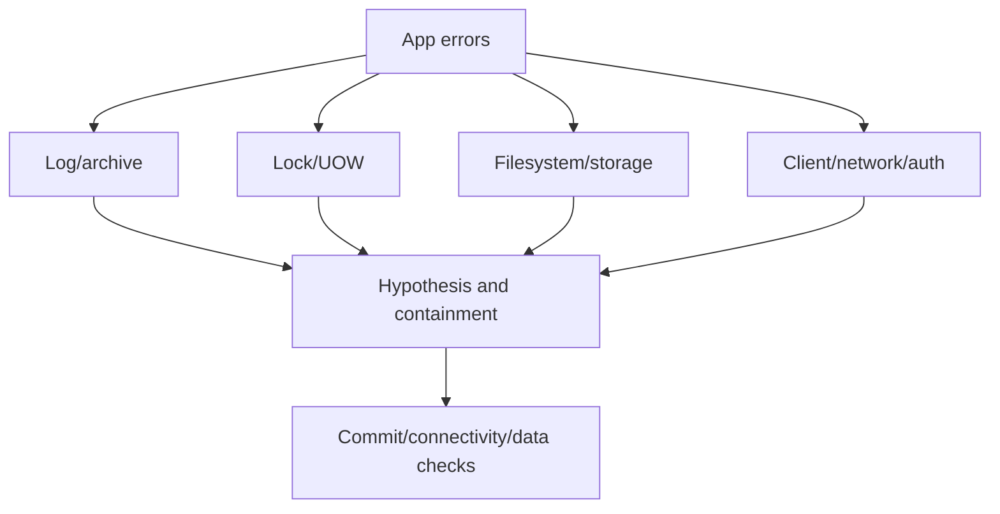

# K-01 — Incident practicum: log full, locks, storage, and connectivity

**Procedure status: NOT YET EXECUTED.** This is a teaching procedure for Db2 LUW 12.1.0 on Linux x86-64, single-member topology. The exact fix pack is not pinned. Engine commands run on the Db2 server as the named instance/database authority; client checks run on the client; OS commands run on the named host and normally require read-only access. Windows, AIX, DPF, and pureScale differences are called out where material. The supplied environment has no Db2 CLI or disposable Db2 server, so no lab command is claimed as executed. Before production use, confirm each command against the installed fix pack and local change controls.

## 1. Quick answer

Use this lesson to make a bounded decision about log-full evidence and containment, blocking transaction and rollback risk, filesystem/container/log capacity. Confirm target, authority, state, and recovery boundary before changing anything.

**Safest first step:** Capture the exact target, release, role, timestamp, and read-only state before acting.

## 2. Learn the concept

Follow log-full evidence and containment; blocking transaction and rollback risk; filesystem/container/log capacity; client/network path diagnosis; cross-layer timeline; service/data verification across the service boundary. Each stage has its own owner and evidence; a successful command is not proof of the business outcome.

### Working model

Decision path: log-full evidence and containment → blocking transaction and rollback risk → filesystem/container/log capacity → client/network path diagnosis → cross-layer timeline → service/data verification. The arrows are dependencies to verify, not proof of causality.



## 3. Choose an approach

| Variant | Choose it when | Do not choose it when / boundary |
|---|---|---|
| Log full | Check active log space, transaction age, and archive destination. | Do not delete active logs or raise limits blindly. |
| Lock storm | Identify blocker, unit of work, and business owner. | Termination may create rollback load. |
| Connectivity/storage overlap | Separate client path from engine, log, or device pressure. | One symptom may have multiple causes. |
| Deadlock or lock timeout | Separate SQL deadlock victim from timeout and identify blocker/UOW. | Do not treat both as log-full symptoms. |
| Tablespace capacity | Check tablespace state, container/filesystem, and growth limit. | Free filesystem bytes do not prove a tablespace can extend. |
| Client connection failure | Walk DNS, route, listener, TLS, authentication, then database state. | TCP success alone does not prove a usable Db2 session. |

## 4. Understand the lifecycle

- Declare impact and confirm host/instance/database/role.
- Capture db2diag, log use, transactions, locks, filesystem, and network.
- Protect recovery chain and stop retry storms.
- Test leading bottleneck with bounded read-only checks.
- Apply approved containment with stop boundary.
- Verify new commits, connectivity, and data correctness.

**Pause/retry/stop/rollback rule:** Stop if target identity, role, authority, prerequisites, data-loss decision, or rollback path is uncertain; preserve evidence and escalate.

## 5. Do the work

### Precheck

- Confirm primary/standby, utility, archive path, log filesystem, and recent changes.
- Align Db2, app, and OS timestamps.
- Name business owner before canceling work or changing timeout.

### Scoped procedures

### Procedure 1: Inspect log state

**Status:** NOT YET EXECUTED. **Run as:** Instance owner. **Target:** Named SAMPLE database. **Authority/prerequisite:** Read-only; verify command support and correct member/role.

```bash
db2pd -db SAMPLE -logs; db2 get db cfg for SAMPLE
```

**Expected result:** Log configuration/use evidence is displayed.

**Independent check:** Correlate transactions, archive status, filesystem, and SQL0964C time.

**Stop/rollback boundary:** Do not remove log files or alter sizing during diagnosis.

### Procedure 2: Inspect lock waits

**Status:** NOT YET EXECUTED. **Run as:** Instance owner. **Target:** Current lock and unit-of-work state. **Authority/prerequisite:** Confirm target/time; identify blocker and rollback risk before intervention.

```bash
db2pd -db SAMPLE -wlocks -transactions
```

**Expected result:** Waiters and transaction evidence are shown.

**Independent check:** Match app handle to owner, SQL, business request, and log use.

**Stop/rollback boundary:** Read-only; force/cancel requires incident approval.

### Procedure 3: Filesystem and client-port check

**Status:** NOT YET EXECUTED. **Run as:** Linux host/client operator. **Target:** Named log/archive filesystems and Db2 listener endpoint. **Authority/prerequisite:** Verify actual mount and configured listener service; netcat syntax differs by platform and TCP success proves neither TLS nor login.

```bash
df -hP /db2log /db2archive; nc -vz dbhost.example.net 50000
```

**Expected result:** Capacity and TCP reachability are sampled.

**Independent check:** Compare free blocks/inodes with log use; then perform a separate TLS/authenticated database check.

**Stop/rollback boundary:** Read-only; do not change firewall or remove files during diagnosis.

### Procedure 4: Check data-space and mount capacity

**Status:** NOT YET EXECUTED. **Run as:** Instance owner and Linux host operator. **Target:** SAMPLE table spaces and mapped data mount. **Authority/prerequisite:** Map the selected table space containers to the actual mount; run read-only checks.

```bash
db2 list tablespaces show detail; df -hP /db2data
```

**Expected result:** Tablespace state, utilization, and filesystem capacity are shown.

**Independent check:** Compare affected object/container path, auto-resize limit, inode availability, and recent growth.

**Stop/rollback boundary:** Read-only; do not delete Db2 files or extend an unapproved volume.

## 6. Worked example and verification

Applications report SQL0964C; the log filesystem is nearly full and one long unit of work blocks cleanup. Check archive destination and transaction state before changing log parameters or terminating work.

**Expected state/result:** Cause-specific containment preserves log/recovery integrity and app commit/connectivity tests pass.

**Independent verification:**

- Compare pre-state and post-state from independent evidence.
- Validate the affected application or business transaction, not only the Db2 return code.

## 7. Diagnose problems

| Symptom or verified error | Evidence to collect | Likely cause | Safe correction and recheck | Avoid |
|---|---|---|---|---|
| SQL0964C continues after capacity change | active transaction, log config, archive destination, db2diag | long transaction or archive failure still blocks reuse | identify consuming work and restore archive path; recheck log state | delete logs or raise every log parameter |
| Connectivity returns but commits fail | route, TLS/auth, database, log/lock state, retries | TCP reachability mistaken for transaction readiness | test authenticated read and bounded commit; reconcile uncertain requests | close incident after TCP connect |
| SQL0911N or repeated lock victim in the incident report | SQLCODE/SQLSTATE, reason code, deadlock event, lock chain, UOW age, and app retry ID | deadlock cycle or lock timeout causes rollback/retry load that may look like log pressure | identify blocker and transaction boundary; coordinate app retry policy and recheck lock waits | force the blocker without estimating rollback or duplicate request effects |
| SQL0289N or table-space extension failure | table-space state, container path, AUTORESIZE/max size, filesystem blocks/inodes, and db2diag | table space or container cannot allocate required extent | restore approved storage/capacity or correct scoped configuration, then validate state and application write | assume free filesystem bytes guarantee table-space headroom |

## 8. Practice

Tabletop log pressure, lock blocker, full archive mount, and client timeout. Build timeline, choose containment, protect logs, define postchecks. No live incident lab; NOT YET EXECUTED.

## 9. Check understanding

**Question:** What must be proven before a log-full incident is resolved?

**Answer and reasoning:** Archive/log reuse is healthy, blocking work is understood, a new transaction commits, client connectivity is stable, and uncertain requests are reconciled.

## 10. Look it up later

### Short checklist

- Name the host, instance, database, member, and role.
- Capture baseline and confirm prerequisites.
- Choose the supported and least disruptive branch.
- Verify state and service behavior independently.
- Record evidence, owner, and recovery boundary.

### Related lessons

[A-04](../A/A-04.md) · [A-05](../A/A-05.md) · [E-01](../E/E-01.md) · [E-02](../E/E-02.md) · [E-04](../E/E-04.md) · [F-01](../F/F-01.md) · [K-02](../K/K-02.md)

### Authoritative references

- [IBM SQL0964C troubleshooting](https://www.ibm.com/docs/en/db2/12.1.x?topic=servers-troubleshooting-full-transaction-log-error)
- [IBM diagnostic log](https://www.ibm.com/docs/en/db2/12.1.x?topic=files-interpreting-diagnostic-log-file-entries)
- [IBM monitor interfaces](https://www.ibm.com/docs/en/db2/12.1.x?topic=monitoring-interfaces-database)
- [IBM lock and deadlock event monitoring](https://www.ibm.com/docs/en/db2/12.1.x?topic=events-lock-deadlock-event-monitoring)
- [IBM SQL0289N table-space capacity guidance](https://www.ibm.com/docs/en/db2/12.1.0?topic=management-system-managed-space)

---

[Domain index](README.md) · [Course index](../README.md) · [Glossary](../GLOSSARY.md)
