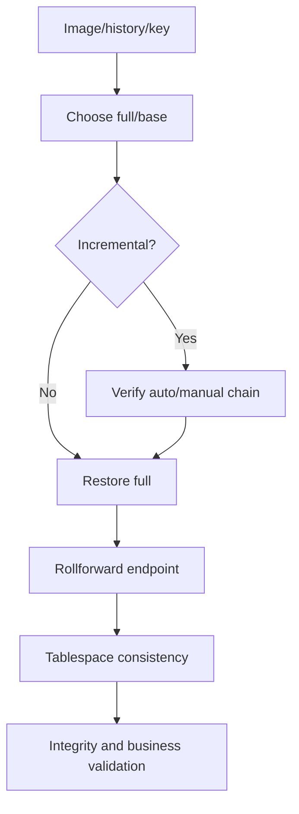

# K-02 — Recovery practicum: full, incremental, point-in-time, and tablespace recovery

**Procedure status: NOT YET EXECUTED.** This is a teaching procedure for Db2 LUW 12.1.0 on Linux x86-64, single-member topology. The exact fix pack is not pinned. Engine commands run on the Db2 server as the named instance/database authority; client checks run on the client; OS commands run on the named host and normally require read-only access. Windows, AIX, DPF, and pureScale differences are called out where material. The supplied environment has no Db2 CLI or disposable Db2 server, so no lab command is claimed as executed. Before production use, confirm each command against the installed fix pack and local change controls.

## 1. Quick answer

Use this lesson to make a bounded decision about full image and isolated restore, automatic incremental chain, manual incremental chain. Confirm target, authority, state, and recovery boundary before changing anything.

**Safest first step:** Capture the exact target, release, role, timestamp, and read-only state before acting.

## 2. Learn the concept

Follow full image and isolated restore; automatic incremental chain; manual incremental chain; rollforward end-of-logs and PIT; tablespace recovery consistency; recovery decision and measured RTO across the service boundary. Each stage has its own owner and evidence; a successful command is not proof of the business outcome.

### Working model

Decision path: full image and isolated restore → automatic incremental chain → manual incremental chain → rollforward end-of-logs and PIT → tablespace recovery consistency → recovery decision and measured RTO. The arrows are dependencies to verify, not proof of causality.



## 3. Choose an approach

| Variant | Choose it when | Do not choose it when / boundary |
|---|---|---|
| Full recovery | Restore known full image and logs if database is recoverable. | Verify image and complete log sequence. |
| Incremental recovery | Use automatic or manual chain documented for selected image. | Never guess or mix image chains. |
| Tablespace/PIT | Recover selected scope only if dependencies remain consistent. | Mixed-time spaces can be business-inconsistent. |
| Offline image | Restore image after offline backup and validate clean database state. | It may not require log rollforward. |
| Online image | Restore online backup and apply required logs to a consistent endpoint. | Image completion alone may leave rollforward pending. |
| Key or identity mismatch | Verify image database/member identity and retrieve required encryption key. | Do not overwrite the source or alter image identity. |

## 4. Understand the lifecycle

- Inventory image history, headers, chains, logs, keys, and capacity.
- Choose full/incremental/database/tablespace path and isolated target.
- Restore base and incrementals in supported order.
- Roll forward to approved end-of-logs or timestamp.
- Validate spaces, integrity, app data, and cross-object consistency.
- Record timing, RPO, gaps, and remaining recovery options.

**Pause/retry/stop/rollback rule:** Stop if target identity, role, authority, prerequisites, data-loss decision, or rollback path is uncertain; preserve evidence and escalate.

## 5. Do the work

### Precheck

- Verify database/image IDs, type, timestamp, chain, platform, and key.
- Confirm logs cover intended endpoint and timezone.
- Keep original source and media untouched.

### Scoped procedures

### Procedure 1: Full isolated restore template

**Status:** NOT YET EXECUTED. **Run as:** Recovery authority. **Target:** Isolated QA1. **Authority/prerequisite:** Verify image, path mapping, capacity, key, and distinct alias; use generated redirected script if required.

```bash
RESTORE DATABASE SAMPLE FROM /db2backup TAKEN AT 20261027100000 INTO QA1 NEWLOGPATH /db2log/QA1 REDIRECT WITHOUT ROLLING FORWARD
```

**Expected result:** Image restores into QA1, possibly pending logs.

**Independent check:** Check messages, paths, and rollforward state before routing.

**Stop/rollback boundary:** Do not replace source; retain recovery evidence.

### Procedure 2: Automatic incremental restore template

**Status:** NOT YET EXECUTED. **Run as:** Recovery authority. **Target:** Isolated QA1. **Authority/prerequisite:** Confirm exact release syntax, base/delta availability, chain IDs, and IBM procedure.

```bash
RESTORE DATABASE SAMPLE INCREMENTAL AUTOMATIC FROM /db2backup TAKEN AT 20261027120000 INTO QA1
```

**Expected result:** Db2 selects automatic chain when the required images are available.

**Independent check:** Check selected images and resulting database data/time.

**Stop/rollback boundary:** If incomplete, stop and use verified manual chain or another full image.

### Procedure 3: Manual incremental sequence

**Status:** NOT YET EXECUTED. **Run as:** Recovery authority. **Target:** Isolated instance containing only disposable SAMPLE. **Authority/prerequisite:** Use documented manual order: target image first for container metadata, then base image, then every increment chronologically; confirm release/path and isolated alias.

```bash
RESTORE DATABASE SAMPLE INCREMENTAL TAKEN AT 20261027120000; RESTORE DATABASE SAMPLE INCREMENTAL TAKEN AT 20261027080000; RESTORE DATABASE SAMPLE INCREMENTAL TAKEN AT 20261027100000; RESTORE DATABASE SAMPLE INCREMENTAL TAKEN AT 20261027120000
```

**Expected result:** Target metadata, base, and incremental images are processed in sequence.

**Independent check:** Check each return code, image history, database state, and target data.

**Stop/rollback boundary:** Stop on failure and use documented INCREMENTAL ABORT cleanup where required before choosing another path.

### Procedure 4: PIT rollforward template

**Status:** NOT YET EXECUTED. **Run as:** Recovery authority and business approver. **Target:** Isolated QA1. **Authority/prerequisite:** Confirm timestamp syntax/timezone and complete logs. This is separate from end-of-logs recovery.

```bash
ROLLFORWARD DATABASE QA1 TO 2026-10-27-10.15.00.000000 AND STOP OVERFLOW LOG PATH (/db2archive/SAMPLE)
```

**Expected result:** Database stops at approved point.

**Independent check:** Query status; test transactions around boundary and application integrity.

**Stop/rollback boundary:** STOP is terminal on this path; wrong point needs another restore/recovery.

### Procedure 5: Tablespace state check

**Status:** NOT YET EXECUTED. **Run as:** Instance owner/recovery operator. **Target:** Recovery target database. **Authority/prerequisite:** Capture object/tablespace dependencies and state before recovery.

```bash
LIST TABLESPACES SHOW DETAIL
```

**Expected result:** Tablespace state and containers are displayed.

**Independent check:** Check all related spaces, constraints, and cross-space application data.

**Stop/rollback boundary:** Read-only; do not open app path while state is pending.

## 6. Worked example and verification

A full image, complete incremental chain, and logs through 10:43 offer different paths. Select supported method and have business owner approve the recovery endpoint and loss.

**Expected state/result:** Practicum documents distinct full, automatic/manual incremental, PIT, and tablespace sequences with state checks, consistency decision, timing, and approval.

**Independent verification:**

- Compare pre-state and post-state from independent evidence.
- Validate the affected application or business transaction, not only the Db2 return code.

## 7. Diagnose problems

| Symptom or verified error | Evidence to collect | Likely cause | Safe correction and recheck | Avoid |
|---|---|---|---|---|
| Missing image/log in chain | history/header, expected next log, checksum, key, chain ID | incomplete transfer, wrong chain, or archive unavailable | retrieve exact dependency or choose earlier legal recovery point | rename unrelated image/log to satisfy sequence |
| Recovered tablespace conflicts with related object | space states, dependency map, commit timestamp, app validation | related spaces restored to different points | recover related spaces to common point or use database PIT | assume physical space normal proves business consistency |
| Encrypted image cannot be opened because key material is unavailable | image header, encryption options, key-manager audit, key label/version, and restore diagnostics | key escrow/credential or provider configuration is missing | retrieve the authorized matching key and test on isolated target before retry | generate a new key and assume it decrypts an existing backup |
| Wrong image or alias selected | image header, database/member identity, timestamp, history, and target alias | ambiguous filename or cross-member image selection | stop before restore continuation; select verified chain and isolated alias | replace the original database based on filename alone |

## 8. Practice

Tabletop an image inventory with missing delta/log, bad commit, and dependent tablespaces. Draw automatic/manual chain, select legal path, estimate data loss, and state stop conditions. No Db2 lab; NOT YET EXECUTED.

## 9. Check understanding

**Question:** What determines whether tablespace recovery is safe?

**Answer and reasoning:** The image/log chain must be complete and the selected point must preserve consistency across dependent objects, spaces, and transactions.

## 10. Look it up later

### Short checklist

- Name the host, instance, database, member, and role.
- Capture baseline and confirm prerequisites.
- Choose the supported and least disruptive branch.
- Verify state and service behavior independently.
- Record evidence, owner, and recovery boundary.

### Related lessons

[F-03](../F/F-03.md) · [F-05](../F/F-05.md) · [F-06](../F/F-06.md) · [F-07](../F/F-07.md) · [F-08](../F/F-08.md) · [F-09](../F/F-09.md) · [J-03](../J/J-03.md)

### Authoritative references

- [IBM BACKUP DATABASE](https://www.ibm.com/docs/en/db2/12.1.x?topic=commands-backup-database)
- [IBM RESTORE DATABASE](https://www.ibm.com/docs/en/db2/12.1.x?topic=commands-restore-database)
- [IBM incremental restore](https://www.ibm.com/docs/en/db2/12.1.x?topic=recovery-restoring-from-incremental-backup-images)
- [IBM rollforward recovery](https://www.ibm.com/docs/en/db2/12.1.x?topic=recover-rollforward-recovery)
- [IBM encrypted backups](https://www.ibm.com/docs/en/db2/12.1.x?topic=encryption-encrypted-backups)
- [IBM native encryption](https://www.ibm.com/docs/en/db2/12.1.x?topic=rest-db2-native-encryption)

---

[Domain index](README.md) · [Course index](../README.md) · [Glossary](../GLOSSARY.md)
