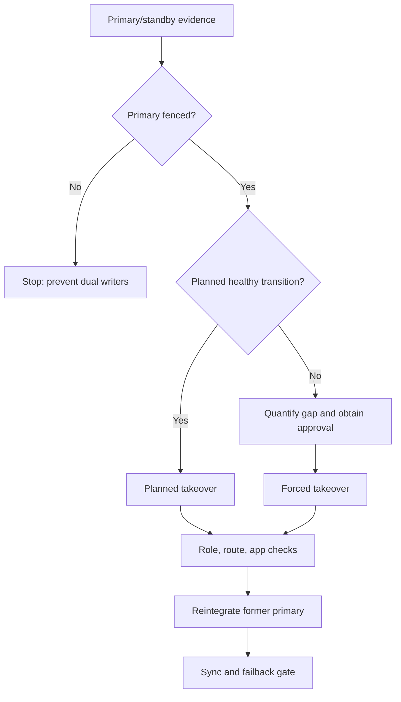

# K-03 — Availability/change practicum: HADR, upgrade, failover, and rollback decisions

**Procedure status: NOT YET EXECUTED.** This is a teaching procedure for Db2 LUW 12.1.0 on Linux x86-64, single-member topology. The exact fix pack is not pinned. Engine commands run on the Db2 server as the named instance/database authority; client checks run on the client; OS commands run on the named host and normally require read-only access. Windows, AIX, DPF, and pureScale differences are called out where material. The supplied environment has no Db2 CLI or disposable Db2 server, so no lab command is claimed as executed. Before production use, confirm each command against the installed fix pack and local change controls.

## 1. Quick answer

Use this lesson to make a bounded decision about HADR role and synchronization, planned takeover and fencing, forced takeover and data-loss gate. Confirm target, authority, state, and recovery boundary before changing anything.

**Safest first step:** Capture the exact target, release, role, timestamp, and read-only state before acting.

## 2. Learn the concept

Follow HADR role and synchronization; planned takeover and fencing; forced takeover and data-loss gate; reintegration and failback; upgrade sequencing; client service verification across the service boundary. Each stage has its own owner and evidence; a successful command is not proof of the business outcome.

### Working model

Decision path: HADR role and synchronization → planned takeover and fencing → forced takeover and data-loss gate → reintegration and failback → upgrade sequencing → client service verification. The arrows are dependencies to verify, not proof of causality.



## 3. Choose an approach

| Variant | Choose it when | Do not choose it when / boundary |
|---|---|---|
| Planned takeover | Use synchronized standby with both endpoints and route plan. | Confirm old primary is fenced. |
| Forced takeover | Use only when primary is unavailable and business owner accepts risk. | Do not promote from one unreachable host alone. |
| Upgrade/change | Follow release-specific HADR upgrade sequencing. | Do not improvise mixed-level/database upgrade order. |

## 4. Understand the lifecycle

- Record roles, states, log positions, sync mode, and route.
- Choose planned/forced from reachability and fencing evidence.
- For forced path, quantify unsent/unreplayed logs and obtain decision.
- Take over using documented method; validate role and client route.
- Reintegrate former primary through supported procedure.
- Fail back after sync, fencing, app test, and change gate.

**Pause/retry/stop/rollback rule:** Stop if target identity, role, authority, prerequisites, data-loss decision, or rollback path is uncertain; preserve evidence and escalate.

## 5. Do the work

### Precheck

- Check both hosts, HADR status, log positions, cluster controls, and route.
- Confirm target fix pack and documented HADR upgrade order.
- Prevent two writable primaries; preserve old primary for safe reintegration.

### Scoped procedures

### Procedure 1: Compare HADR endpoints

**Status:** NOT YET EXECUTED. **Run as:** HADR operator. **Target:** Primary and standby. **Authority/prerequisite:** Collect on both hosts with timestamps.

```bash
db2pd -db PROD -hadr
```

**Expected result:** Each endpoint reports role/state/log evidence where reachable.

**Independent check:** Compare sync state, log gap, peer, and topology controls.

**Stop/rollback boundary:** Read-only.

### Procedure 2: Planned takeover template

**Status:** NOT YET EXECUTED. **Run as:** HADR operator with approved change. **Target:** Healthy synchronized standby. **Authority/prerequisite:** Check takeover prerequisites, fencing, route, and app-owner approval first.

```bash
TAKEOVER HADR ON DB PROD
```

**Expected result:** Standby becomes primary after supported transition.

**Independent check:** Check both roles, reroute, TLS/auth, and a real app commit.

**Stop/rollback boundary:** Do not take over again until former primary is reintegrated/synchronized.

### Procedure 3: Forced takeover emergency template

**Status:** NOT YET EXECUTED. **Run as:** HADR operator with business approval. **Target:** Standby PROD only after primary is confirmed stopped/fenced. **Authority/prerequisite:** Use only under documented failover decision; confirm allowed standby state, log gap, data-loss approval, and old-primary fencing.

```bash
TAKEOVER HADR ON DB PROD BY FORCE
```

**Expected result:** Standby becomes primary if takeover is accepted.

**Independent check:** Verify role on both endpoints, route, and application transaction; document possible lost work.

**Stop/rollback boundary:** Never route writes until old primary is fenced; reintegrate/reinitialize former primary as documented.

### Procedure 4: Upgrade readiness gate

**Status:** NOT YET EXECUTED. **Run as:** Instance owner / upgrade lead. **Target:** Rehearsal database and planned production database. **Authority/prerequisite:** Use target-version tool and required database state; inspect the complete log before scheduling.

```bash
db2ckupgrade PROD -l /db2upgrade/PROD.log
```

**Expected result:** Readiness output reports blockers and warnings for review.

**Independent check:** Confirm all databases/partitions are covered and close every blocker before fix-pack/upgrade sequence.

**Stop/rollback boundary:** Read-only precheck; a pass does not authorize takeover or database upgrade.

## 6. Worked example and verification

For planned maintenance, verify synchronization and application route before a normal takeover. Forced takeover is a separate emergency decision with quantified possible data loss.

**Expected state/result:** Decision tree states roles, exposure, allowed takeover, reintegration, upgrade sequencing, rollback limit, and client acceptance.

**Independent verification:**

- Compare pre-state and post-state from independent evidence.
- Validate the affected application or business transaction, not only the Db2 return code.

## 7. Diagnose problems

| Symptom or verified error | Evidence to collect | Likely cause | Safe correction and recheck | Avoid |
|---|---|---|---|---|
| Standby disconnected or replay lagging | HADR state, send/receive/replay position, db2diag, network and archive | transport failure or replay bottleneck | repair the specific layer and quantify gap before role change | promote as if synchronized |
| Former primary may still accept writes | old host state, fencing, route, storage lease and cluster control | dual-writer risk or stale route | fence and isolate before routing; reintegrate by supported process | fail back immediately or trust DNS alone |
| HADR transition or upgrade gate is blocked | HADR role/state, utility/upgrade status, log positions, db2diag, and fix-pack matrix | upgrade in progress, unsupported sequence, or standby outside takeover-eligible state | stop role change; finish/abort the documented maintenance phase and validate both endpoints | force takeover while upgrade state or fencing is unresolved |

## 8. Practice

Tabletop healthy planned takeover, isolated primary with unknown log gap, lagging standby, and former-primary return. State decision owner, fencing proof, app tests, reintegration, failback gates. No HADR lab; NOT YET EXECUTED.

## 9. Check understanding

**Question:** What evidence is mandatory before forced takeover?

**Answer and reasoning:** Primary is unavailable or fenced, standby role and last received/replayed logs are known, business owner accepts quantified loss, and client route is controlled.

## 10. Look it up later

### Short checklist

- Name the host, instance, database, member, and role.
- Capture baseline and confirm prerequisites.
- Choose the supported and least disruptive branch.
- Verify state and service behavior independently.
- Record evidence, owner, and recovery boundary.

### Related lessons

[G-01](../G/G-01.md) · [G-02](../G/G-02.md) · [G-03](../G/G-03.md) · [G-04](../G/G-04.md) · [I-02](../I/I-02.md) · [I-03](../I/I-03.md) · [K-01](../K/K-01.md) · [K-02](../K/K-02.md) · [K-04](../K/K-04.md)

### Authoritative references

- [IBM HADR configuration](https://www.ibm.com/docs/en/db2/12.1.x?topic=hadr-database-configuration)
- [IBM TAKEOVER HADR](https://www.ibm.com/docs/en/db2/12.1.x?topic=commands-takeover-hadr)
- [IBM installFixPack](https://www.ibm.com/docs/en/db2/12.1.x?topic=commands-installfixpack-update-installed-db2-database-products)
- [IBM UPGRADE DATABASE](https://www.ibm.com/docs/en/db2/12.1.x?topic=commands-upgrade-database)
- [IBM HADR failover procedure](https://www.ibm.com/docs/en/db2/12.1.x?topic=outage-performing-hadr-failover-operation)
- [IBM upgrade readiness check](https://www.ibm.com/docs/en/db2/12.1?topic=tasks-verifying-that-your-databases-are-ready-upgrade)

---

[Domain index](README.md) · [Course index](../README.md) · [Glossary](../GLOSSARY.md)
