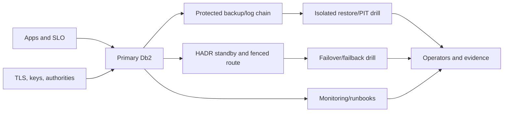

# K-04 — Enterprise capstone: architecture, security, recovery, performance, and operations

**Procedure status: NOT YET EXECUTED.** This is a teaching procedure for Db2 LUW 12.1.0 on Linux x86-64, single-member topology. The exact fix pack is not pinned. Engine commands run on the Db2 server as the named instance/database authority; client checks run on the client; OS commands run on the named host and normally require read-only access. Windows, AIX, DPF, and pureScale differences are called out where material. The supplied environment has no Db2 CLI or disposable Db2 server, so no lab command is claimed as executed. Before production use, confirm each command against the installed fix pack and local change controls.

## 1. Quick answer

Use this lesson to make a bounded decision about workload objectives and SLO, topology and independent failure domains, HADR/replication role and client route. Confirm target, authority, state, and recovery boundary before changing anything.

**Safest first step:** Capture the exact target, release, role, timestamp, and read-only state before acting.

## 2. Learn the concept

Follow workload objectives and SLO; topology and independent failure domains; HADR/replication role and client route; logs, backup, encryption, and keys; TLS, authorities, and secrets; monitoring, runbooks, and tested recovery across the service boundary. Each stage has its own owner and evidence; a successful command is not proof of the business outcome.

### Working model

Decision path: workload objectives and SLO → topology and independent failure domains → HADR/replication role and client route → logs, backup, encryption, and keys → TLS, authorities, and secrets → monitoring, runbooks, and tested recovery. The arrows are dependencies to verify, not proof of causality.



## 3. Choose an approach

| Variant | Choose it when | Do not choose it when / boundary |
|---|---|---|
| Single member with HADR | Use when standby and failover meet the service objective. | HADR does not protect from logical corruption. |
| DPF/pureScale | Select only for workload need and operating maturity. | Their member/partition/CF scopes differ. |
| Replication/federation | Select for distribution/integration requirement. | Define lag, consistency, conflict, and licensing. |

## 4. Understand the lifecycle

- Set transaction SLO, RPO/RTO, data classification, and constraints.
- Choose topology and map primary/standby, route, storage, sites, and key access.
- Design logs, backup, restore, encryption, TLS, privileges, and secret rotation.
- Define monitoring, runbooks, schedule owners, and change gates.
- Test site loss, takeover/failback, restore/PIT, key outage, and capacity.
- Review evidence, residual risks, support, and next improvement.

**Pause/retry/stop/rollback rule:** Stop if target identity, role, authority, prerequisites, data-loss decision, or rollback path is uncertain; preserve evidence and escalate.

## 5. Do the work

### Precheck

- Name SLO and data-loss decision owner; measurable acceptance is required.
- Verify current platform support and feature entitlements.
- Check that site, key, network, storage, and power dependencies are independent.

### Scoped procedures

### Procedure 1: Check HADR endpoints

**Status:** NOT YET EXECUTED. **Run as:** HADR operator. **Target:** Both PROD endpoints. **Authority/prerequisite:** Collect from both hosts; verify roles, log positions, peer state, sync mode, and routing. Do not promote from one output.

```bash
db2pd -db PROD -hadr; db2 get db cfg for PROD
```

**Expected result:** HADR state and configuration clues are recorded.

**Independent check:** Compare architecture, fencing, client path, and measured log gap.

**Stop/rollback boundary:** Read-only.

### Procedure 2: Check backup evidence

**Status:** NOT YET EXECUTED. **Run as:** Backup/recovery operator. **Target:** History and selected image. **Authority/prerequisite:** Use exact image path and documented checker syntax; protect storage identifiers.

```bash
db2 list history backup all for PROD; db2ckbkp -h /db2backup/PROD.0.db2inst1.DBPART000.20261027100000.001
```

**Expected result:** History and image header are displayed if readable.

**Independent check:** Compare identity, date, chain, checksum, key, and isolated restore result.

**Stop/rollback boundary:** Read-only; do not replace/delete image from header output alone.

## 6. Worked example and verification

Two HADR VMs share a storage failure domain and a single-site key vault. Network redundancy does not prove site resilience; map dependencies and test key retrieval during DR.

**Expected state/result:** Review package has objectives, topology/trust boundaries, failover and recovery plans, security, alerts/runbooks, measured drills, and prioritized residual risks. Capstone scoring covers target identification, evidence quality, safe action, independent verification, rollback/escalation, and stakeholder communication.

**Independent verification:**

- Compare pre-state and post-state from independent evidence.
- Validate the affected application or business transaction, not only the Db2 return code.

## 7. Diagnose problems

| Symptom or verified error | Evidence to collect | Likely cause | Safe correction and recheck | Avoid |
|---|---|---|---|---|
| Takeover succeeded but clients fail | role, fencing, DNS/load balancer, TLS trust, credentials, firewall, retries | database role changed but route/trust dependency did not | test full app path and keep old writer fenced | declare DR from takeover output alone |
| Bad data propagated to standby | replication mode/lag, transaction timeline, backup and PIT test | HA confused with independent corruption recovery | keep protected backup and separate PIT drill | use standby as only recovery copy |

## 8. Practice

Present architecture and synthetic evidence to DBA, app, security, network/storage, and operations reviewers. Tabletop site loss, key outage, log pressure, and bad transaction. No Db2 cluster; all execution NOT YET EXECUTED. Score each area against a stated rubric and record any critical safety failure separately from the numeric score.

## 9. Check understanding

**Question:** What proves a Db2 service is recoverable and operable?

**Answer and reasoning:** Known ownership/topology, independent failure domains, usable security/key paths, actionable alerts, and measured restore/failover drills meeting business targets.

## 10. Look it up later

### Short checklist

- Name the host, instance, database, member, and role.
- Capture baseline and confirm prerequisites.
- Choose the supported and least disruptive branch.
- Verify state and service behavior independently.
- Record evidence, owner, and recovery boundary.
- Score target, evidence, action, verification, recovery/escalation, and communication separately.

### Related lessons

[B-06](../B/B-06.md) · [D-01](../D/D-01.md) · [D-04](../D/D-04.md) · [E-06](../E/E-06.md) · [F-03](../F/F-03.md) · [F-05](../F/F-05.md) · [G-01](../G/G-01.md) · [G-02](../G/G-02.md) · [G-04](../G/G-04.md) · [I-05](../I/I-05.md) · [J-01](../J/J-01.md) · [J-02](../J/J-02.md) · [J-03](../J/J-03.md) · [J-05](../J/J-05.md) · [K-01](../K/K-01.md) · [K-02](../K/K-02.md) · [K-03](../K/K-03.md)

### Authoritative references

- [IBM HADR configuration](https://www.ibm.com/docs/en/db2/12.1.x?topic=hadr-database-configuration)
- [IBM TAKEOVER HADR](https://www.ibm.com/docs/en/db2/12.1.x?topic=commands-takeover-hadr)
- [IBM BACKUP DATABASE](https://www.ibm.com/docs/en/db2/12.1.x?topic=commands-backup-database)
- [IBM RESTORE DATABASE](https://www.ibm.com/docs/en/db2/12.1.x?topic=commands-restore-database)
- [IBM rollforward recovery](https://www.ibm.com/docs/en/db2/12.1.x?topic=recover-rollforward-recovery)
- [IBM configure TLS](https://www.ibm.com/docs/en/db2/12.1?topic=ctcsc-configure-tls-db2-server)
- [IBM Db2 native encryption](https://www.ibm.com/docs/en/db2/12.1.x?topic=rest-db2-native-encryption)
- [IBM Db2 12.1 changed authority behavior](https://www.ibm.com/docs/en/db2/12.1.x?topic=121-changed-functionality)
- [IBM monitoring interfaces](https://www.ibm.com/docs/en/db2/12.1.x?topic=monitoring-interfaces-database)

---

[Domain index](README.md) · [Course index](../README.md) · [Glossary](../GLOSSARY.md)
